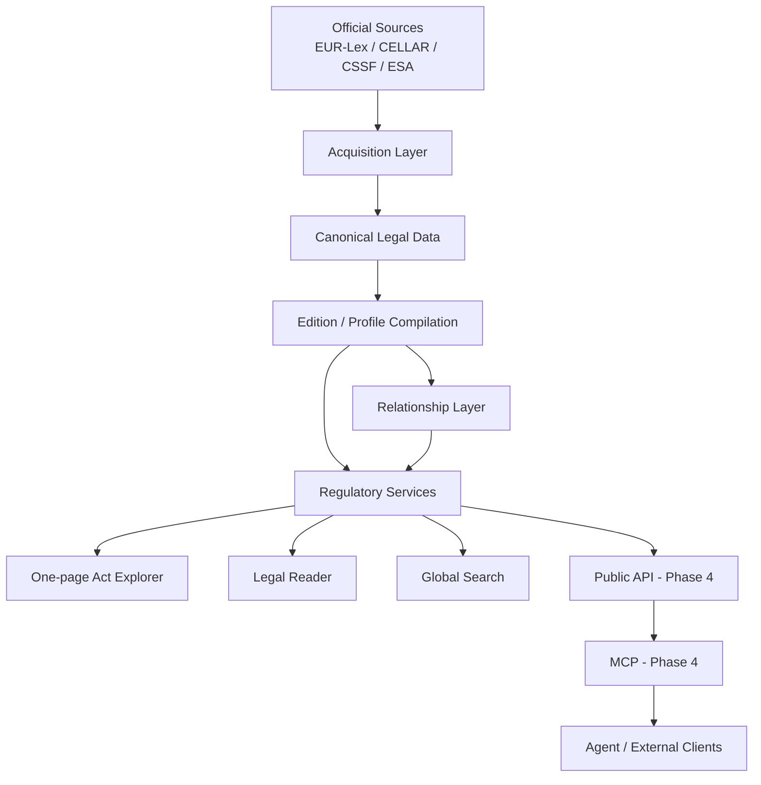
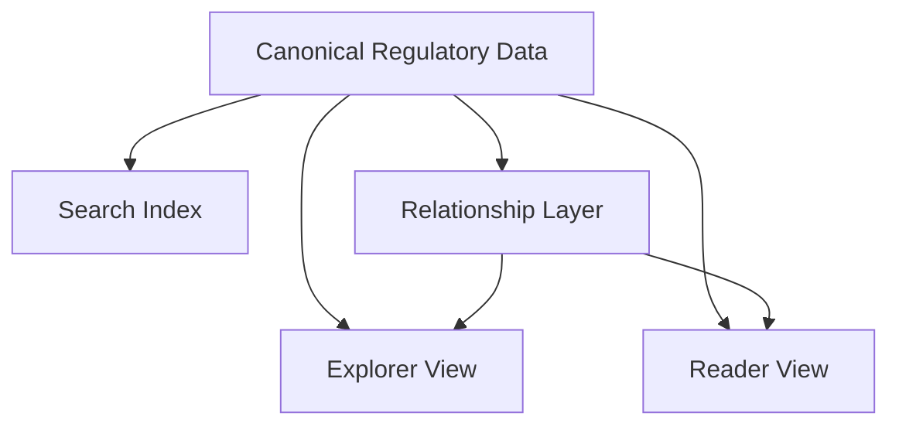
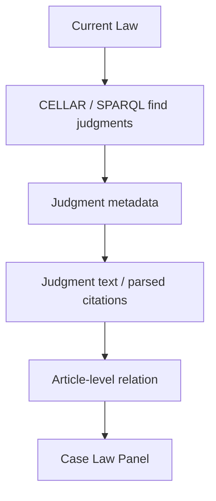
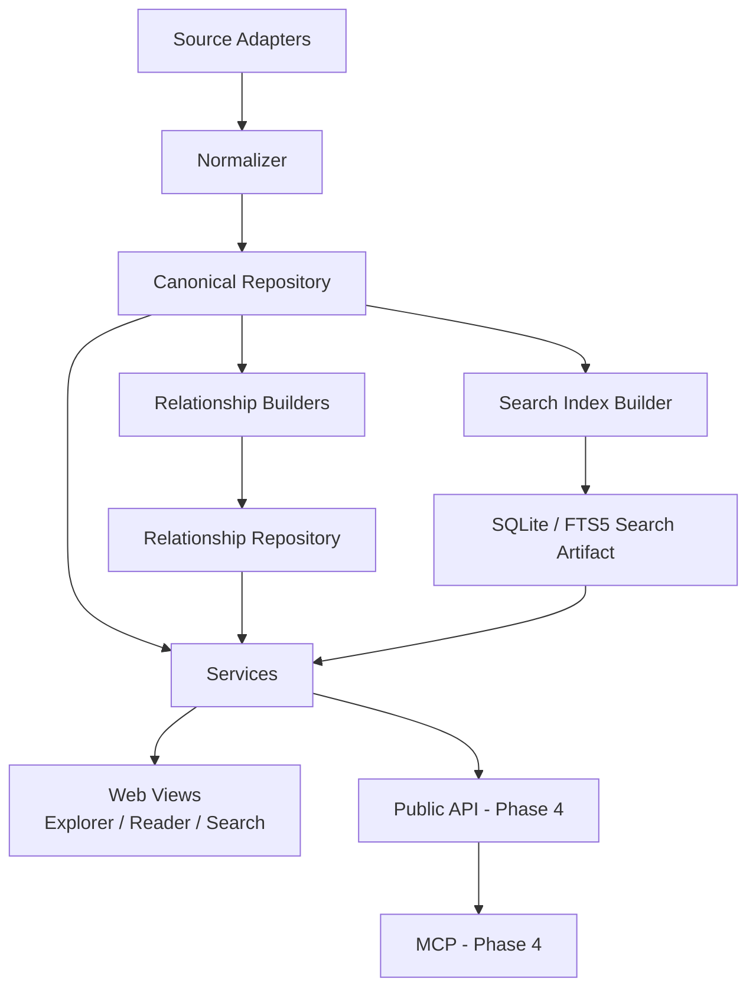

# Regulatory Knowledge Platform — 产品需求规格说明书

> 文档版本：v3.5 Profile Compilation Implemented
> 日期：2026-08-25
> 产品语言：English  
> 需求文档语言：中文  
> 文档用途：作为独立 Git 工程的产品需求、阶段规划与架构约束基线

---

## 0. 文档目标

本文定义一个独立的 **European Financial Regulatory Knowledge Platform**。产品以官方 EU / Luxembourg 监管法规为底座，提供高质量 Legal Reader、法规内部与法规之间的关系导航，并逐步演进为可被 MCP、Agent 以及其他外部应用调用的监管知识服务。当前 ICT / cyber / data 语料是第一个可用纵向切片，不是平台最终的金融业务边界。

本文只描述本项目自身要建设的能力，并按照 **Phase 1 / Phase 2 / Phase 3 / Phase 4** 明确演进路径。Phase 1 是完整的产品阶段，但必须拆成可独立运行、可连续发布的 `Release 0.1–0.6`，不能把所有能力绑定成一次性交付。后续阶段的需求在本文中提前定义，是为了保证核心标识和数据来源可演进，而不是要求 Phase 1 提前实现未来抽象。

产品的核心原则：

> **Official source as truth → Normalize once → Reuse everywhere → Relationships first-class → Multiple views over one canonical dataset → APIs and MCP follow.**

同时采用两个明确的工程策略：

> **Reuse proven patterns first.** 对已经被优秀开源法规产品验证过、且与本项目目标高度一致的能力，优先复用、适配或按其成熟实现重构，而不是为了“自主实现”重复造轮子。只有当现有实现无法覆盖本项目的法规范围、数据结构或产品目标时，才开发新的专用实现。

> **Ship broad coverage incrementally.** 多法规覆盖是产品目标，但先建立可运行的纵向链路，再扩展覆盖和关系深度；每个 Release 都必须能够独立构建、部署和使用。

这条原则尤其适用于 LegalViz.EU 已经验证成熟的 Formex parser、Legal Reader 交互、Adaptive TOC、Global Search / Command Palette、SQLite FTS5 搜索、reference resolver、client-side inverted index、TF-IDF、deep link、URL state、definition lookup、References / Cited By 等能力；同时借鉴 artificialintelligenceact.eu 的整部法案单页 Explorer 体验，将 **Explore 与 Read 设计为同一份 Canonical Legal Data 的两种一等视图**。

产品需要同时满足两组目标：

1. **对用户简单**：打开法规、找到章节、读 Article、点击引用、查看相关 RTS/ITS/Recital/Case，路径直观；
2. **对数据消费者可靠**：为其他 Agent / RAG 产品提供结构化、可追溯、可重建的法规数据与检索上下文；
3. **对架构稳健**：法规结构差异、未来新增数据源、CJEU、CELLAR、MCP、Knowledge Graph 等能力均通过清晰模块扩展，而不是在 UI 中不断增加特例判断。

---

# 1. 产品愿景

## 1.1 一句话定义

**An English European financial regulatory knowledge platform, combining authoritative legal text, excellent navigation, explainable legal relationships, and reusable structured data.**

中文理解：

> 一个面向 EU 与 Luxembourg 金融监管法规的统一英文知识平台：既像优秀的 Legal Reader 一样好读，又能让用户沿着 Article、Recital、Annex、RTS/ITS、其他法规和判例之间的关系自然探索，并为 Agent / RAG 提供同源、可引用的数据能力。

## 1.2 产品价值

官方法律网站的价值是权威，但通常存在以下阅读摩擦：

- 长法规的目录层级深，定位慢；
- Article、Recital、Annex、RTS/ITS 分散；
- 正文存在大量 `Article X`、`Annex Y`、`Regulation (EU) ...` 引用，用户需要频繁跳页；
- 用户很难快速看到“当前条文引用了什么”和“哪些条文引用了当前条文”；
- DORA、MiCA 等金融监管法规不能只看 Level 1 Act，还需要同时理解 Level 2 / Level 3 文件；
- 不同法规使用 Chapter、Title、Part、Section 等不同层级，普通网站很难保持统一阅读体验；
- 法规版本、修订、实施措施、判例等关系分散在不同官方来源。

本平台需要将这些信息统一为一个清晰的阅读体验，同时保持每条数据可追溯至官方来源。

## 1.3 目标用户

Phase 1 主要面向：

- Compliance / Regulatory professionals
- ICT Risk / Operational Risk
- Internal Audit
- Cybersecurity / IT Security
- Legal / Legal Operations
- Technology / Architecture / Engineering staff who need to read regulation
- Researchers / students working with EU regulation

Phase 4 通过 Public API/MCP 进一步面向：

- AI Agent builders
- Internal compliance tools
- Regulatory workflow applications
- Research automation tools

---

# 2. 总体产品结构

平台由六个长期稳定的能力层组成：



各层职责必须清晰：

### Acquisition Layer
负责“拿到官方数据”，不负责 UI，也不负责生成法律解释。

### Canonical Legal Data
负责把不同来源、不同法律结构规范化为平台统一可消费的数据模型。

### Edition / Profile Compilation
从完整 Canonical corpus 中确定性选择一个产品版本允许使用的 Document、Definition、Relationship 与 Search 范围。Profile 不删除或修改 Canonical 数据，也不代表最终法律适用性判断。

### Relationship Layer
负责建立、存储和查询法规之间的关系，包括显式引用、反向引用、RTS/ITS mapping、TF-IDF related recitals，以及后续 CELLAR/CJEU 关系。

### Regulatory Services
为 Explorer、Reader、Search、API、MCP 提供统一的法规读取与关系查询能力，避免任一前端视图直接依赖 raw XML/PDF 或具体文件结构。Explorer 与 Reader 必须读取同一实体、同一 stable ID 和同一 relationship dataset。

### Delivery Layer
包括 One-page Act Explorer、Web Legal Reader、Global Search，以及 Phase 4 Public API/MCP 等不同消费方式。不同交付形式共享相同的 canonical data 和 relationship data，不允许为 Explorer、Reader 或 Search 各维护一套法规副本。

---

# 3. 阶段规划总览

## 3.1 Phase 1 — Regulatory Reader Foundation

目标：做出一个已经具有独立产品价值、可以长期作为后续能力基础的法规阅读平台。

Phase 1 最终完成范围如下；这些能力按 Release 逐步交付，前序 Release 不等待全部项目完成：

- English EUR-Lex FMX 数据底座；
- 核心法规解析与统一 Canonical Legal Model；
- CSSF selected documents 适配；
- 通用 Adaptive TOC；
- **Universal One-page Act Explorer（P0）**：每一部结构化法规自动拥有整部法案单页鸟瞰视图；
- **Explorer / Reader 共用同一 Canonical Legal Data 与 stable IDs**；
- Legal Reader 三栏界面；
- Article / Recital / Annex 阅读；
- Paragraph-level anchor / permalink；
- 正文内部可点击引用；
- Side Peek；
- References / Cited By；
- TF-IDF Article ↔ Recital；
- DORA ↔ RTS/ITS；
- **Global Regulatory Search / Command Palette（P0）**；
- **Find Laws / Opened Laws / Definitions / Full-text Search 四种搜索模式**；
- **SQLite + FTS5 作为全局搜索主索引**；
- **当前法规内部 client-side inverted index / Quick Go**；
- **Explorer 内结构搜索/高亮与 Reader 精确跳转联动**；
- short name / CELEX / year-number / legal citation 的 deterministic query rewrite 与 ranking；
- 官方来源、CELEX、版本等 metadata；
- Relationship Panel；
- 稳定的数据、service 和 repository 边界，为 Phase 2/3 产品能力及 Phase 4 Public API/MCP 预留接口。

Phase 1 的实现策略应尽量沿用已经验证的简单方案：**结构化法律数据 + 预计算 SQLite 索引 + 轻量 deterministic ranking + 浏览器端即时导航**，避免在首阶段引入不必要的重型搜索或分布式基础设施。

Phase 1 内部发布边界：

| Release | 可独立使用的结果 |
|---|---|
| `0.1` | 六部核心 EU 法规的 Canonical Data、Reader、TOC、Article/Recital/Annex、deep link、来源与版本状态 |
| `0.2` | Universal Explorer、Explorer ↔ Reader、全局法规发现、Quick Go、基础全文搜索 |
| `0.3` | Definitions、完整 Command Palette、搜索评测集与可重建 FTS5 artifact |
| `0.4` | Inline references、cross-law resolver、Side Peek、References / Cited By |
| `0.5` | DORA/MiCA Level 2、Relationship Panel、可选 TF-IDF Related Recitals |
| `0.6` | CSSF representative documents、PDF fallback、可访问性、性能和部署完善 |

每个 Release 使用自己的验收门槛。Phase 1 总验收用于表示完整阶段完成，不阻塞前序版本发布。
## 3.2 Phase 2 — Official Relationship Layer

目标：从“高质量法规阅读器”升级为“官方关系增强的监管知识产品”。

Phase 2 建设：

- CELLAR SPARQL / RDF official relationship enrichment；
- Amendment / Corrigendum / Legal Basis / Implementing Act 链；
- CJEU case law；
- Article-level case citation；
- Version / consolidated text relationship；
- 2D relationship graph view；
- 更完整的 RTS / ITS / Guidelines / Q&A 体系；
- Search relation filters / advanced filters；
- 关系数据缓存与可重建机制。
- 最小 Edition/Profile 编译闭环，确保 Reader、Search、Graph 与 Runtime 使用同一 corpus 边界。

## 3.3 Phase 3 — Regulatory Intelligence Platform

目标：在稳定法规底座和关系图谱之上建立更完整的 regulatory intelligence。

Phase 3 建设：

- Regulatory topic / taxonomy view；
- Article ↔ regulatory decision / authority decision；
- national / DPA / CSSF supervisory decision extension；
- applicability / obligation timeline；
- implementation timeline；
- Regulatory Family 跨文件全局视图；
- focused knowledge graph persistence（必要时引入 GraphDB）；
- explainable multi-hop regulatory paths；
- deterministic applicability / compliance navigation；
- richer cross-regulation comparison and navigation。
- 从 ICT / digital 横向法规扩展到金融业务法规，以 Banking Governance & Internal Control 作为首个非 IT 纵向切片；
- provision-level Regulatory Domain、Authority 与 EU → national jurisdiction 关系；
- 面向 Agent / RAG 的内部结构化检索与 citation-ready context assembly。

## 3.4 Phase 4 — External Integration Platform

目标：在 Phase 2/3 的数据、关系与智能产品稳定后，将同一 service capabilities 安全地开放给外部开发者、Agent 与第三方应用。

Phase 4 建设：

- versioned Public API；
- API authentication / keys；
- rate limiting、usage policy 与 operational monitoring；
- external developer documentation；
- MCP server；
- structured SDK / client examples；
- Agent integrations；
- 受控 Edition/Profile 选择及其授权策略；
- API/MCP compatibility and deprecation policy。

Phase 2/3 可以持续增加产品内部 API endpoint 和 service capability，但这些接口在 Phase 4 前不构成公开兼容承诺。

## 3.5 One Platform, Multiple Editions

平台只维护一份代码、一套 Canonical Contract 和一条数据生产流水线，不为银行、基金、保险或数字资产复制独立系统。不同产品版本通过 Edition/Profile 生成：

- Banking Edition；
- Digital Assets / MiCA Edition；
- Funds / Asset Management Edition；
- Insurance Edition；
- Cross-sector Digital / ICT Edition。

每个 Edition 可以拥有不同的默认 corpus、taxonomy、导航和部署名称，但必须复用相同 stable IDs、relationship semantics、services 和 runtime schema。同一代码可以构建多个独立只读 SQLite artifact，并部署为不同服务；当前不建设多租户或运行时任意切库。

Profile 是产品范围配置，不是无条件的法律适用性结论。例如 `banking-default` 可以默认弱化 MiCA，但经营 crypto-asset 业务的银行仍可能需要包含 MiCA。此类差异由后续机构活动与 applicability 规则表达，不应写死在法规分类中。

## 3.6 Build the Capability Before Scaling Coverage

阶段验收采用 **0→1 capability before 1→100 coverage**：

- 每一种新来源先用少量 representative documents 打通 acquisition → canonical → relationships → runtime → delivery；
- 每一种新关系先用少量经审核样本定义方向、端点、provenance 和 evidence；
- 能力闭环完成后，后续批量覆盖进入版本控制的 Coverage Backlog，不阻塞当前 Phase；
- 新增下一批法规时必须使用可重跑流水线，不接受只在本地临时修改生成物的手工导入；
- 自动构建与法律语义审核必须分开，审核结果以版本控制的数据保存，而不是保存在人员或模型记忆中。

---

# 4. Phase 1 数据范围

## 4.1 语言范围

平台法规内容统一使用 **English**。

所有数据模型、slug、搜索索引、关系解析和 UI 首先围绕英文构建。数据结构不得依赖具体英文显示文本作为唯一标识，稳定 ID 必须与显示语言解耦，以保证未来如需扩展语言时不需要改变核心实体标识。

## 4.2 EUR-Lex 数据

使用 EUR-Lex 官方 **English FMX / Formex XML** 作为 EU 法规的主要机器可读底座。

需求：

- `Release 0.1` 优先按 CELEX 获取六部核心法规，形成快速、可验证的输入集；
- 完整 English FMX dump 作为扩大覆盖和批量验证能力，在核心法规链路稳定后引入；
- raw data 与解析结果分离；
- raw data 不作为 Web 运行时依赖；
- build / ingestion 后生成 canonical normalized data；
- 第一阶段优先保证核心法规的解析正确性；
- parser 设计必须能够逐步覆盖更广的 EU legal acts；
- 所有 normalized document 必须保留其 official source / CELEX / source snapshot 信息；
- 支持显式刷新、checksum/metadata 变更检测和失败回退；新 snapshot 未通过质量门槛时不得替换当前可用 artifact。

Phase 1 核心法规：

| Family | Primary Act | 类型 |
|---|---|---|
| DORA | Regulation (EU) 2022/2554 | Regulation |
| GDPR | Regulation (EU) 2016/679 | Regulation |
| AI Act | Regulation (EU) 2024/1689 | Regulation |
| MiCA | Regulation (EU) 2023/1114 | Regulation |
| NIS2 | Directive (EU) 2022/2555 | Directive |
| Data Act | Regulation (EU) 2023/2854 | Regulation |

`MORE` 入口的数据结构需要支持后续直接加入：AMLR、AMLD6、PSD2/PSD3/PSR、MiFID II/MiFIR、CRA、DSA、DMA 等。

## 4.3 CSSF 数据

CSSF 作为一个 **Authority / Regulatory Family** 处理，而不是假设它是一部单一 Regulation。

Phase 1 至少选择一组具有代表性的 CSSF 文件验证通用模型，优先覆盖：

- ICT / IT risk
- cybersecurity
- internal governance
- outsourcing / ICT third-party risk
- DORA-related supervisory material

支持的 document types 至少预留：

- Circular
- CSSF Regulation
- FAQ
- Guideline / Guidance
- Decision / Communication

CSSF 文档允许来自 HTML 或官方 PDF。每份文档仍然必须被转换为与 EU legal acts 共用的 Canonical Document Model。

---

# 5. Canonical Legal Data Model

这是整个项目最关键的长期约束之一。

目标不是让所有法规“原始结构一样”，而是让不同结构都可以通过同一套 Reader 和 Relationship Layer 消费。

## 5.1 核心思想

采用：

> **Common Reader Shell + Document-specific Structural Path**

即：

- UI 是统一的；
- 法规的原始层级语义必须保留；
- Chapter / Title / Part / Section 可以自由组合；
- 缺少某层时不创建假的结构；
- CSSF 可以拥有比 EUR-Lex Regulation 更深的结构；
- 前端通过通用 TOC builder 渲染，而不是为每部法规写专用页面。

## 5.2 Document

每一部法律文件都是一个 Document。

Document 至少需要表达：

- stable document ID
- display title
- short title / family title
- CELEX（如适用）
- document number
- document type
- jurisdiction
- issuing authority
- publication date
- application / effective date（如可可靠获取）
- source URL
- official source type
- source snapshot / version
- consolidated/original status
- regulatory family IDs（多对多）
- available content collections
- language
- logical document ID 与 source expression/version ID
- last checked / ingestion status

`available content collections` 用于描述该文件是否有：

- Articles
- Recitals
- Annexes
- Definitions
- Chapters / Titles / Parts
- supporting documents

## 5.3 Provision

Article、Recital、Annex、Paragraph、Point 等都属于可稳定寻址的 legal content entity。

Provision 必须具有：

- stable provision ID
- document ID
- provision type
- number / label
- title
- official text
- structural path
- parent provision（如有）
- child provisions（如有）
- anchor ID
- source reference
- display order
- language
- source expression/version ID
- source locator（XML node/path、HTML selector 或 PDF page/heading evidence）
- parser warnings（如有）


## 5.4 Definition

Definition 是 Phase 1 的一等可检索实体，而不是仅作为正文中的装饰信息。

Definition 至少需要表达：

- stable definition ID；
- term / normalized term；
- official definition text；
- source document ID；
- source provision ID；
- paragraph / point locator（如适用）；
- jurisdiction / authority；
- imported / reused definition relation（如可以可靠解析）；
- source reference。

Definition 必须能够支持：

- Global Search 中独立的 `Definitions` 模式；
- Reader 正文中的 defined-term hover / Side Peek；
- 同一术语跨法规比较的 Phase 2 扩展；
- MCP/API 对精确定义的确定性读取。

Definition 数据应由 Canonical Legal Data 派生，不允许前端临时从 HTML 文本正则拼装。

## 5.5 Structural Path

Structural Path 是保证不同法规结构可以统一渲染的核心。

示例仅用于说明数据概念：

```json
{
  "type": "article",
  "number": "6",
  "title": "ICT risk management framework",
  "structural_path": [
    {"type": "chapter", "number": "II", "title": "ICT risk management"},
    {"type": "section", "number": "I", "title": "..."}
  ]
}
```

MiCA 可能出现：

```text
TITLE → CHAPTER → ARTICLE
```

AI Act 可能出现：

```text
CHAPTER → SECTION → ARTICLE
```

CSSF 可能出现：

```text
PART → CHAPTER → SECTION → PARAGRAPH
```

Reader 不修改这些原始语义标签，只将其映射为通用 structural nodes。

## 5.6 Stable IDs

稳定 ID 是后续 Relationship、API、MCP、Case Law、Graph 和 permalink 的基础。

要求：

- ID 不依赖显示标题；
- 标题变化不得导致 ID 变化；
- URL slug 可以变化，但 stable ID 不变化；
- Article / Paragraph / Annex 等都拥有独立稳定 ID；
- 关系数据只引用 stable ID，不直接依赖 UI URL；
- 外部标识如 CELEX、ECLI 作为 external identifiers 保存，而不是代替内部主 ID；
- logical entity ID 与某次 source expression/version 分离；同一 Article 的不同 consolidated snapshot 不得被误认为同一份文本内容；
- ID 生成和规范化规则必须文档化，并覆盖 `Article 6a`、重复编号、Annex 内嵌结构及 CSSF 非规则编号；
- anchor 与 logical ID 建立稳定映射，但 anchor 不充当数据主键。

## 5.7 Regulatory Family

Family 是将 Level 1 Act、Level 2 Measures、Guidelines、Q&A 等聚合在一起的产品概念。

例如 DORA Family：

```text
DORA
├── Primary Regulation
├── Recitals
├── RTS
├── ITS
├── Guidelines
├── Q&A
└── Related official documents
```

Family 与单个 Document 分离。一个 Family 可以包含多个 Document，一个 Document 也可与其他 Family 建立关系。

---

# 6. Relationship Model

Relationship 必须作为一等数据实体，而不是只存在于 HTML 链接中。

## 6.1 核心要求

任何关系必须能够回答：

- source 是谁；
- target 是谁；
- relation type 是什么；
- 关系如何获得；
- 关系是否来自官方文本、官方 metadata、人工 mapping 或算法；
- 是否有 evidence；
- 算法关系是否有 method / score；明确法律或官方关系不使用算法 score 冒充置信度；
- 是否可反向查询；
- 是哪一版 builder / source snapshot 生成；
- target 是 resolved、external、unresolved 还是 ambiguous。

示例数据结构仅用于说明：

```json
{
  "source": "AI_ACT_ART_6_P1",
  "relation": "REFERENCES",
  "target": "AI_ACT_ANNEX_I",
  "provenance": "LEGAL_TEXT",
  "evidence_locator": "source span / XML path",
  "builder_version": "explicit-reference@1"
}
```

TF-IDF relationship：

```json
{
  "source": "AI_ACT_ART_6",
  "relation": "RELATED_RECITAL",
  "target": "AI_ACT_RECITAL_47",
  "provenance": "TFIDF",
  "score": 0.84
}
```

## 6.2 Provenance

必须至少支持：

| Provenance | 含义 |
|---|---|
| `LEGAL_TEXT` | 正文明确引用 |
| `OFFICIAL_METADATA` | EUR-Lex / CELLAR official metadata |
| `OFFICIAL_MAPPING` | EBA/ESMA/ESA/CSSF 等官方映射 |
| `CASE_TEXT` | 判决正文引用 |
| `EDITORIAL` | 人工维护关系 |
| `TFIDF` | 文本相关度关系 |

同一 pair 可以存在不同 provenance 的 relationship。

产品必须能够区分：

- **explicit legal relationship**；
- **official metadata relationship**；
- **editorial relationship**；
- **similarity/recommendation relationship**。

这一区分同时用于 UI、未来 API/MCP 和数据审计。

## 6.3 Phase 1 Relationship Types

Phase 1 至少支持：

- `REFERENCES`
- `CITED_BY`（由 REFERENCES 反向生成或查询）
- `RELATED_RECITAL`
- `MANDATES`
- `ADOPTED_UNDER`
- `SUPPLEMENTS`
- `RELATED_DOCUMENT`

RTS / ITS 是目标 Document 的类型，不再编码为两套平行 relation types。每种关系必须定义方向、inverse、适用 node types 和语义说明；`CITED_BY` 默认作为 `REFERENCES` 的反向查询视图。

关系类型必须可扩展，Phase 2 可以无破坏地加入：

- `AMENDS`
- `AMENDED_BY`
- `CORRIGENDUM_OF`
- `LEGAL_BASIS`
- `INTERPRETED_BY`
- `CITED_BY_CASE`
- `CONSOLIDATED_BY`

---

# 7. Phase 1 — Global Information Architecture

## 7.1 顶部一级导航

Desktop 顶部主要法规入口：

```text
DORA   GDPR   AI ACT   MiCA   NIS2   CSSF   MORE ▾
```

目标：用户始终知道当前处在哪个 Regulatory Family，并可快速切换。

`MORE` 使用可搜索/可扩展菜单，避免将大量法规横向塞入主导航。

MORE 的长期分组能力：

- EU Regulations / Directives
- Financial Services
- Cybersecurity / Digital
- Supervisory Authorities
- Luxembourg

## 7.2 Regulatory Family Landing Page

每个 Family 有统一外壳，但内容 tab 根据 Family 的 available collections 动态出现。

### DORA

优先 tab：

```text
EXPLORE | READ | RECITALS | RTS / ITS | GUIDELINES
```

### GDPR

```text
EXPLORE | READ | RECITALS | GUIDANCE
```

### AI Act

```text
EXPLORE | READ | RECITALS | ANNEXES | IMPLEMENTATION
```

### MiCA

```text
EXPLORE | READ | RECITALS | RTS / ITS | GUIDELINES
```

### NIS2

```text
EXPLORE | READ | RECITALS | ANNEXES
```

### CSSF

```text
EXPLORE | CIRCULARS | REGULATIONS | FAQ | GUIDANCE
```

CSSF Family 的 `EXPLORE` 首先承担文档集合导航；当进入某一已结构化 Circular / Regulation 后，该文档继续拥有通用的 `EXPLORE | READ` 双视图。

这些 tab 不是硬编码“法规类型”，而是由 Family 配置和 available collections 驱动。对于拥有明确主法案的 Family，默认入口优先为 `EXPLORE`，使用户先获得整部法规的结构认知，再进入逐条 `READ`。

## 7.3 Family Landing 内容

统一包含：

- Full title
- Short title
- document type
- CELEX / official identifier
- publication / application metadata
- official source link
- short neutral description
- document collections summary
- relationship summary
- recently opened / quick entry（可选）

DORA / MiCA 等 family 额外显示 Level 2 summary：

```text
RTS: n
ITS: n
Guidelines: n
```

这些统计数字可点击进入对应 library。

---

# 8. Phase 1 — Universal One-page Act Explorer

One-page Act Explorer 是 Phase 1 的核心产品视图之一，产品形态重点参考 `artificialintelligenceact.eu/ai-act-explorer/` 的整部法案平铺方式，但实现必须成为平台级通用能力，而不是某一法规的专用页面。

## 8.1 产品定位

Explorer 解决的问题不是“精读某一个 Article”，而是：

> **让用户在一个连续页面中看懂整部法规的骨架、章节分布和条文位置，并能从宏观结构自然进入具体条文。**

Explorer 与 Reader 是互补关系：

```text
EXPLORE
整部法规鸟瞰 / 结构认知 / 快速定位
        ↕
READ
单条法规精读 / 引用关系 / Side Peek
```

Explorer 必须具有足够完整的独立产品感，但在数据和技术上不是独立系统。

## 8.2 One Canonical Dataset, Multiple Views

Explorer、Reader、Search、Relationship Panel 必须消费同一份 Canonical Legal Data。



明确约束：

- 不为 Explorer 维护第二套 Article/Recital/Annex 数据；
- Explorer 与 Reader 对同一 Article 使用同一个 stable entity ID；
- Explorer 中点击的 Article 与 Search / Reader / Relationship 中的 Article 必须是同一实体；
- 结构变化只由 Canonical Model / `structural_path` 反映，不允许通过页面特例复制数据；
- Explorer Renderer 仅负责“如何展示结构”，不负责重新解释法律结构。

## 8.3 Universal Explorer Renderer

Explorer 必须是平台能力，而不是法规专用功能。

只要一个 Document 能被解析为标准 structural tree / `structural_path`，它就自动拥有 Explorer。

至少覆盖：

- DORA；
- GDPR；
- AI Act；
- MiCA；
- NIS2；
- Data Act；
- 已结构化的 CSSF Circular / Regulation；
- 后续加入 MORE 的任何结构化 Regulation / Directive。

Renderer 不判断“这是 DORA 还是 GDPR”，只消费通用结构节点，例如：

```text
TITLE / PART / CHAPTER / SECTION / SUBSECTION / ARTICLE / PROVISION
```

因此：

```text
DORA     → Chapter → Section → Article
GDPR     → Chapter → Section → Article
AI Act   → Chapter → Section → Article
MiCA     → Title → Chapter → Article
NIS2     → Chapter → Article
CSSF     → Part → Chapter → Section → Provision
```

都由同一个 Explorer Renderer 输出，同时保留原始法律结构名称，不能为了视觉统一把 `TITLE` 改写成 `CHAPTER`。

## 8.4 页面视觉层级

Explorer 需要有明显的“整部法案地图”感，而不是把左侧 TOC 简单放大。

推荐视觉层级：

1. **Document / Family header**：法规全名、short name、status、official identifier；
2. **Top-level division**：Title / Part / Chapter 使用大字号、明显留白；
3. **Section / Subsection**：次一级标题；
4. **Article / Provision**：Article number + title，保持高密度、易扫描；
5. **Relationship badges**：只显示轻量 count，不展开复杂关系。

示意：

```text
CHAPTER V
MANAGING ICT THIRD-PARTY RISK

Section I
General principles

Article 28
General principles                           RTS 2 · ITS 1

Article 29
Preliminary assessment of ICT concentration risk

Article 30
Key contractual provisions                  RTS 3 · Refs 7
```

视觉原则：

- 以 typography、spacing、hierarchy 形成结构，不依赖大量卡片；
- 页面可以非常长，连续滚动是 Explorer 的核心体验；
- Chapter / Title 之间需要足够视觉断点；
- Article 列表保持紧凑，避免每条做成大型卡片；
- relationship 信息只做 badge / count，避免把 Explorer 变成 Dashboard；
- official text 不在默认 Explorer 中整段展开，避免失去鸟瞰能力。

## 8.5 Explorer 中的关系提示

Phase 1 可以在 Article 行旁显示轻量关系 badge，例如：

```text
RTS 2 · ITS 1 · Recitals 5 · Refs 4
```

要求：

- badge 数据来自同一 Relationship Repository；
- 只显示有数据的类型；
- badge 只承担“存在关系”的提示，不在 Explorer 中展开全部内容；
- 点击 Article 进入 Reader 查看详细 Relationship Panel；
- 点击 RTS/ITS badge 可进入相应 relation list / library；
- 算法关系（如 TF-IDF Recital）与官方关系在底层 provenance 上继续区分。

## 8.6 Explorer ↔ Reader 双向导航

Phase 1 必须实现基础双向流转：

- Explorer 点击 Article → 打开同一 Article 的 Reader；
- Reader 提供 `View in Explorer` / 等价入口；
- 从 Reader 返回 Explorer 时，尽量恢复原 Article 所在滚动位置；
- Explorer 中当前/最近访问 Article 可轻量高亮；
- Article permalink 与 Explorer 定位使用同一 stable ID；
- browser back/forward 不丢失主要阅读位置。

推荐路由语义：

```text
/family/explore
/family/article/{number}
```

实际 URL 结构可在技术设计阶段确定，但必须满足“同一实体、多视图、可深链”的原则。

## 8.7 Explorer 与 Global Search 联动

Global Search 与 Explorer 不是两套搜索。

Phase 1 需要支持：

- Global Search 结果可以直接进入 Reader；
- 可提供 `Locate in Explorer` 行为，将目标 Article 定位到整部法规中；
- 在 Explorer 页面触发结构内搜索时，可高亮匹配 Article / Section；
- 未匹配区域可以弱化，但不应破坏整体结构；
- Search 使用同一 stable IDs，不通过标题字符串猜测定位。

Phase 2/3 可以继续增强：

- relation-aware highlight；
- 从 Graph / Case / RTS 反向定位到 Explorer；
- 多跳路径在 Explorer 中标示相关区域；
- 跨法规 Explorer 间的上下文跳转。

## 8.8 Density / 展示密度

默认优先提供高质量的 `Normal` 密度。

未来可增加：

- `Compact`：只显示结构 + Article number/title；
- `Normal`：结构 + Article + 轻量 badges；
- `Detailed`：增加短 preview / metadata。

Phase 1 不要求必须实现三档切换，但 DOM / component contract 不应假设 Article row 永远只有两行文本，以便后续扩展。

## 8.9 CSSF Explorer 特殊处理

CSSF 需要区分两个层次：

1. **CSSF Family Explorer**：浏览 Circulars / Regulations / FAQ / Guidance 等文档集合；
2. **CSSF Document Explorer**：对某一已结构化 Circular / Regulation 展示完整 Part / Chapter / Section / Provision。

两者共用 Family/Document metadata 与 stable IDs，但不是同一个层级树。

## 8.10 Explorer 的产品原则

> **Explorer is a platform capability, not a regulation-specific feature.**

新增一部法规的理想路径应是：

```text
New Official Document
→ Parse / Normalize
→ structural_path available
→ Explorer automatically available
→ Reader automatically available
→ Search automatically indexable
→ Relationships automatically attachable
```

新增法规不应要求复制 Explorer 页面代码。

---

# 9. Phase 1 — Legal Reader

Legal Reader 是 Phase 1 的核心页面。

## 9.1 Desktop Layout

优先采用 LegalViz 类似的三栏阅读结构：

```text
┌─────────────────┬──────────────────────────────┬─────────────────────┐
│ TOC / Structure │ Legal Text                   │ Relationships       │
│                 │                              │                     │
│ Chapter / Title │ Article 7                    │ Recitals            │
│ Section         │ Title                        │ Case law*           │
│ Article         │ Paragraphs                   │ References          │
│                 │ Points                       │ Cited by            │
│                 │ Inline links                 │ RTS / ITS           │
└─────────────────┴──────────────────────────────┴─────────────────────┘
```

右侧内容根据当前阶段和当前 Article 的可用关系动态显示。

## 9.2 左侧 TOC

必须支持：

- Chapter / Title / Part / Section / Article 任意合理组合；
- 当前节点高亮；
- 当前 Chapter 自动展开；
- 非当前 Chapter 可折叠；
- sidebar 独立滚动；
- 点击 Article 后 sidebar 保留当前位置；
- Article number + short title；
- 显示 Article range，例如 `Art. 7–13`；
- 当前 Article previous / next 快速跳转；
- Quick Go 输入框；
- 可直接输入 `23`、`art 23`、`rec 40`、`annex 2`；
- chapterless document 自动 graceful flatten；
- 无 title 的结构层不显示假标题；
- 原始结构 label 必须保留，如 `TITLE II` 不应被改成 `CHAPTER II`。

## 9.3 中间正文区

正文区必须优先保证法规阅读质量：

- Article number 清楚；
- Article title 明显；
- Structural breadcrumb，例如 `Chapter II — ICT risk management`；
- paragraph number 保持原文；
- point `(a)`, `(b)`, `(i)` 等保持原文结构；
- tables / lists / indents 尽量保留；
- inline citations 具有一致 link style；
- 不将算法推荐文本混入 official legal text；
- official text 与 editorial metadata 视觉分离。

## 9.4 右侧 Relationship Panel

参考 LegalViz 的 tab 形式，并根据可用数据动态出现。

Phase 1 至少：

```text
RECITALS | REFERENCES | CITED BY | LEVEL 2
```

当 Phase 2 有 case law 时自动出现：

```text
CASE LAW
```

每个 tab 显示 count，例如：

```text
Recitals 8
References 4
Cited by 11
RTS / ITS 3
```

Panel 必须独立滚动，不能影响正文位置。

## 9.5 Theme

视觉风格参考：

- LegalViz：沉浸式三栏、暗色阅读、关系 panel；
- ai-act-law.eu / gdpr-info.eu：克制、轻量、法律文本优先；
- artificialintelligenceact.eu：Article metadata 与 TOC 清晰区分。

Phase 1 支持 dark / light 两套主题，共用相同布局和信息层级。

---

# 10. Adaptive TOC — 结构不一致的统一方案

这是平台能否长期扩展的关键需求。

## 10.1 目标

不同法规可以有不同的法律层级，但用户看到的 Reader 交互应该保持一致。

平台必须做到：

- 不要求所有法规拥有相同层级；
- 不强行把 Title/Part/Chapter 转换为同一个概念；
- 允许结构层缺失；
- 允许 CSSF 等非 EUR-Lex 文档出现更深层级；
- UI 使用统一递归/树形渲染逻辑；
- 数据差异由 normalization 处理，不由页面特例处理。

## 10.2 参考 LegalViz 的做法

LegalViz 的核心思路值得直接借鉴：

- parser 先将 Formex 结构整理成 Reader-friendly hierarchy；
- UI 不针对 GDPR、NIS2、AI Act 分别写不同页面；
- chapterless laws 自动 flatten；
- section 只有存在时才显示；
- 原始结构标签保留；
- TOC 与正文基于同一份 normalized structure。

本项目在此基础上增加 `structural_path`，用于覆盖 CSSF 和更复杂结构。

## 10.3 一致性标准

同一套 Reader Shell 必须适配至少以下样本：

```text
DORA: Chapter → Section → Article
GDPR: Chapter → Section → Article
AI Act: Chapter → Section → Article + Annex
MiCA: Title → Chapter → Article
NIS2: Chapter → Article + Annex
CSSF: Part / Chapter / Section / Paragraph（按具体文档）
```

验收时至少选择每一种结构各一份文件验证。

---

# 11. Inline Legal Links — 正文内链接

正文中的可点击关系是 Reader 的核心实用能力，不是装饰功能。

## 11.1 Phase 1 需要识别的链接类型

### 同一 Document 内

- Article
- Article + paragraph
- Article + point
- Annex
- Chapter
- Section
- Recital（如原文明示）

例如：

```text
Article 49(2)
Annex III
Article 6(1)(a)
```

### 跨 Document

需要识别并 resolve：

- Regulation (EU) YYYY/NNNN
- Directive (EU) YYYY/NNNN
- older forms such as Directive 95/46/EC
- named acts when official identifier can be reliably resolved

链接目标优先进入本平台对应 Document / Provision；若目标尚未入库，则提供 official source link。

## 11.2 关系生成优先级

1. Formex 中已有明确 link / identifier：直接使用；
2. 正文中可确定解析的 legal reference：规则解析；
3. cross-document reference：通过 identifier / CELEX resolver 解析；
4. 无法确定目标时保留原文，不创建错误关系。

原则：宁可少链接，也不生成错误法律引用。

## 11.3 Side Peek

点击 inline legal link 默认优先打开 Side Peek，而不是立即离开当前阅读位置。

Side Peek 至少显示：

- target identifier；
- title；
- relevant paragraph / excerpt；
- parent document；
- `Open full article/document`；
- official source link（适用时）。

Side Peek 必须支持：

- Article → Article；
- Article → Annex；
- Article → Other Regulation / Directive；
- Article → RTS/ITS（当关系已存在）。

用户关闭 Side Peek 后应回到原正文位置。

## 11.4 Link Presentation

需要视觉区分：

- official explicit reference；
- related/recommended item；

正文 explicit reference 使用正常 legal link 视觉；TF-IDF related recitals 不直接伪装成正文法律链接，而主要显示在 Relationship Panel。

---

# 12. Paragraph-level Deep Linking

平台必须能够精确定位到 Article 内的 Paragraph / Point。

目标：

- Article URL 可分享；
- Paragraph URL 可分享；
- 点击外部链接后自动滚动并高亮目标；
- anchor 稳定；
- Side Peek 可以定位到目标 paragraph；
- 后续 API/MCP 可使用同一 stable anchor。

示意：

```text
/dora/article/6
/dora/article/6#para-8
/ai-act/article/6#para-1-point-a
```

具体 URL 格式可以由实施阶段决定，但必须满足稳定和可读两个要求。

---

# 13. Relationship Builder — Phase 1

Relationship Builder 是独立高内聚模块。

它的输入是 canonical legal data，输出是统一 relationship dataset。

它不负责页面渲染，不依赖 Web 组件。

## 13.1 Explicit Reference Builder

负责：

- Article → Article
- Article → Paragraph
- Article → Annex
- Article → Other Act
- Document → Other Document

输出关系必须包含：

- source；
- target；
- relation type；
- provenance；
- evidence；
- source location。

## 13.2 Reverse Relation

`CITED_BY` 不需要作为另一套解析逻辑。

已有：

```text
A REFERENCES B
```

即可反向查询：

```text
B CITED_BY A
```

存储层可以选择物化或查询时生成，但对上层 service contract 必须表现一致。

## 13.3 DORA / MiCA Level 2 Mapping

Phase 1 允许采用官方来源确认后的 mapping 数据，并作为 `OFFICIAL_MAPPING` 保存。

关系至少支持：

```text
RTS/ITS → ADOPTED_UNDER → Article
Article → MANDATES → RTS/ITS
```

当官方依据只支持一般相关性、补充或细化关系时，使用 `RELATED_DOCUMENT` / `SUPPLEMENTS`，不得一律表述为 implements。

每条 mapping 必须保留：

- source Article；
- target Level 2 document；
- official title；
- document number / CELEX；
- relation evidence / mandate wording；
- official source；
- mapping provenance。

人工核验 mapping 必须作为版本控制的 source data 保存，并由 builder 导入 Relationship Repository；UI 不直接读取 DORA/MiCA 专用 mapping 文件。

当前 Release 0.5 纵切已验证 DORA/MiCA 的多种映射形态，包括 DORA Delegated Regulation (EU) 2024/1774 同时对应 Article 15 与 Article 16、MiCA Delegated Regulation (EU) 2025/305 对应 Article 62，以及 DORA Article 20 同时授权重大 ICT 事件报告 RTS 2025/301 与 ITS 2025/302。7 份 Level 2 法规均作为完整 Document 进入 Reader、Explorer、Search 和统一 Entity Store；8 条核验记录生成 16 条 `OFFICIAL_MAPPING` 有向边。后续扩充 RTS/ITS 只增加 official source registry、Canonical artifact 与 curated mapping record，不增加法规专用 UI 或表。

## 13.4 TF-IDF Article ↔ Recital

TF-IDF 是 Phase 1 的可选增强功能，安排在 explicit references 和 DORA/MiCA official mappings 之后。它不阻塞 `Release 0.1–0.4` 发布，只有通过小型人工 benchmark 后才默认展示。

目标：根据文本相关度为每个 Article 推荐最相关的 Recitals。

需求：

- 以单部法规为计算域；
- Article 和 Recital 使用 normalized text；
- 采用 TF-IDF + cosine similarity；
- ingestion/build 时计算，不要求页面实时计算；
- 默认保存 Top N related recitals；
- 保存 score；
- relation provenance 为 `TFIDF`；
- 可配置最低 score threshold；
- 可配置 Top N；
- UI 将其表达为 `Related Recitals`，并与 explicit reference 区分；
- benchmark 至少定义一组人工确认的 Article ↔ Recital pairs，并评估 Top-N 命中情况；未达到约定质量门槛时可以关闭展示；
- score 表示文本相似度，不得命名或表达为法律置信度。

TF-IDF 的目的不是法律推断，而是提高阅读探索效率。

当前实现使用版本控制的 8-case benchmark 覆盖 DORA、GDPR 与 AI Act，Top 5 case hit rate 门槛为 100%。完整 benchmark 通过后，只为这三部已核验法案发布 build-time `RELATED_RECITAL`；不完整测试语料或门禁失败时发布 0 条算法关系。SQLite 与 API 保留 cosine similarity score、`TFIDF` provenance 和 builder version，score 仍仅表示文本相关度。

## 13.5 Relationship Rebuild

Relationship Builder 必须支持可重复构建：

```text
Canonical Data
      ↓
Relationship Builder
      ↓
Relationship Dataset
```

relationship dataset 可以删除后重新生成，不应要求人工恢复内部计算结果。

人工确认的 official mappings 应作为独立 source data 保存，不能混在生成结果中丢失 provenance。

---

# 14. DORA Regulatory Family — Phase 1 专项需求

DORA 是 Phase 1 用于验证“主法 + Level 2”的核心样本。

## 14.1 DORA Landing

需要展示：

- Regulation full title；
- Regulation number；
- CELEX；
- publication / application metadata；
- Official Source；
- Articles；
- Recitals；
- RTS / ITS；
- Guidelines collection slot；
- Level 2 summary count。

## 14.2 RTS / ITS Library

RTS / ITS 必须既能独立浏览，又能作为 Article relationship node 使用。

列表需要支持：

- Type：RTS / ITS；
- title；
- Commission Regulation number；
- CELEX；
- publication date；
- relevant DORA Article / mandate；
- status / source；
- official link。

## 14.3 Article 页面

若当前 Article 存在 Level 2 mapping，则右侧 `LEVEL 2` tab 显示：

- RTS / ITS type；
- official title；
- short identifier；
- mandate / relationship；
- click → Side Peek；
- open full document。

## 14.4 Search Result Context

搜索结果中允许使用轻量 badge，例如：

```text
DORA · Article 28
Related: 2 RTS · 1 ITS
```

搜索结果不展开完整关系，完整信息留在 Reader / Level 2 library。

---

# 15. Recital Experience

## 15.1 Recital Browser

Recital 作为独立可导航 entity：

- 有自己的 stable ID；
- 可从 TOC / Quick Go 打开；
- 支持 previous / next；
- 可建立 permalink；
- 可 Side Peek；
- 可以看到 Related Articles（反向 TF-IDF）。

## 15.2 Related Recitals Panel

Article 页面显示 Top related recitals。

每条显示：

- Recital number；
- short text excerpt；
- score 不必默认展示给普通用户，但必须保留在数据中；
- click → Side Peek；
- open full recital。

如果某关系来自 editorial/manual，而非 TF-IDF，UI 可通过 tooltip/source detail 展示 provenance。

---

# 16. Annex Experience

Annex 作为独立 content collection，不混在 Article tree 中强行扁平化。

要求：

- Annex list；
- Annex number/title；
- internal heading；
- table/list preservation；
- paragraph / point anchor；
- Article → Annex link；
- Annex → Article cited-by；
- Side Peek；
- permalink。

AI Act、NIS2、Data Act 用作 Annex renderer 的重点验证样本。

---

# 17. Global Regulatory Search & Quick Navigation

Global Search 是 Phase 1 的 **P0 产品能力**。它不是普通页面搜索框，而是一个全站一致的 **Command Palette / Regulatory Search Surface**。

核心交互参考 LegalViz.EU：任何页面均可通过 `Cmd/Ctrl + K` 打开居中悬浮搜索界面，输入过程中实时刷新结果，支持键盘完整操作，并能够在“找法规、最近法规、定义、全文”之间快速切换。

## 17.1 Global Command Palette

Command Palette 必须满足：

- 任意页面可打开；
- 首页搜索框与 Reader 内搜索调用同一组件与同一 Search Service；
- 输入即搜索，不要求点击 Search；
- 支持 `Esc` 关闭；
- 支持 `↑ / ↓` 选择结果；
- 支持 `Enter` 打开；
- 支持键盘切换搜索模式；
- 打开后保持当前页面上下文，关闭后回到原位置；
- 搜索结果打开后必须落到稳定 Document / Provision / anchor URL；
- 搜索输入和模式切换不得触发整页刷新。

默认视觉结构参考：

```text
Search input
────────────────────────────────────────
Find laws | Opened laws | Definitions | Full-text search
────────────────────────────────────────
BEST MATCH
...
ALL RESULTS
...
────────────────────────────────────────
↑↓ navigate   ↵ open   ⇥ mode   esc close
```

## 17.2 Search Modes

### A. Find Laws

用于定位法规、监管文件和 Regulatory Family。

至少支持：

- short name：DORA / GDPR / AI Act / MiCA / NIS2；
- full official title；
- common title；
- CELEX；
- Regulation / Directive / Decision number；
- `year/number`；
- legal citation；
- document type；
- selected CSSF document number / title；
- DORA RTS / ITS document title。

结果至少显示：

- display title；
- official title / excerpt；
- document type；
- date；
- CELEX / external identifier；
- status（如可可靠确定）；
- family；
- selected topics / tags（如已有可靠 metadata）。

必须产生明确的 `Best Match`，不能简单按字符匹配顺序展示。

### B. Opened Laws

用于快速切回近期阅读过的法规。

要求：

- 不要求用户账号；
- 至少记录最近打开的 Document / Family；
- 本地保存；
- 打开速度应接近即时；
- 最近记录与搜索索引解耦；
- 可清除本地历史。

### C. Definitions

Definition 是独立搜索模式。

至少支持：

- exact term；
- normalized term；
- prefix；
- term phrase；
- 返回定义正文片段；
- 返回来源 Article / provision；
- 点击进入来源 provision；
- 同一 term 存在多部法规定义时，结果必须按来源区分。

Phase 1 目标不是做词典式语义推理，而是提供**精确、可追溯的 legal definition lookup**。

### D. Full-text Search

搜索已入库 English legal text。

至少覆盖：

- Article；
- Recital；
- Annex；
- RTS / ITS；
- selected CSSF content。

搜索要求：

- 多个非引号词默认采用严格 AND 语义；
- 普通词支持 prefix matching；
- `"quoted phrase"` 支持 phrase match；
- 结果返回 excerpt / snippet；
- 搜索命中词高亮；
- 可限制到当前 CELEX / Document；
- global search 默认避免同一 Document 产生过多重复结果；
- current-document scoped search 可返回多个匹配 provision；
- 点击结果直接进入目标 provision / paragraph anchor。

## 17.3 Deterministic Query Understanding

Global Search 的第一层“智能”采用 deterministic rules，不依赖 LLM。

至少识别：

- CELEX；
- Regulation / Directive / Decision number；
- `year/number`；
- common acronyms；
- known legal aliases；
- Article / Recital / Annex locator；
- Family short name；
- selected CSSF naming conventions。

例如：

```text
dora            → Regulation 2022/2554
nis2            → Directive 2022/2555
32022R2554      → exact CELEX
2022/2554       → structured year/number match
DORA article 28 → family + provision intent
recital 79      → recital locator intent
```

Search Ranking 需要维护：

- known aliases；
- acronym variants；
- normalized title；
- compact title；
- CELEX；
- type/year/number；
- exact match reason；
- fallback lexical score。

原则：

> **Exact legal identity beats fuzzy text relevance.**

## 17.4 Search Storage / Index Baseline

Phase 1 默认采用 **precomputed SQLite + FTS5** 作为全局搜索底座。

该方案直接参考 LegalViz 的成熟实践，并作为本项目默认实现基线：

- law/document metadata 使用普通 SQLite tables；
- full-text excerpts 使用 FTS5 virtual table；
- definitions 使用独立 FTS5 index；
- index 在 ingestion/build 阶段预生成；
- Web 运行时不读取 raw FMX 或 bulk dump；
- raw FMX、normalized legal data、search index 三者分离；
- Search Service 只读稳定 index / repository contract；
- 搜索索引可以完全重建。

全文 FTS 必须保留 phrase search 与位置/高亮所需的信息，tokenizer 需支持 Unicode / diacritics normalization。

Phase 1 不要求独立搜索集群。单机 SQLite 是默认产品假设；未来只有在数据规模、并发或部署模式出现实际瓶颈时才替换底层实现，Search Service contract 不因此改变。

## 17.5 In-document Search / Quick Go

当前打开的法规内部继续提供比 Global Search 更快的导航层。

支持输入：

```text
7
art 7
article 7
rec 57
recital 57
annex 3
```

精确 locator 跳转优先于全文搜索。

当前法规内部的 title/text 快速过滤可以采用浏览器端 inverted index，使：

- Article / Recital / Annex 即时过滤；
- 无额外 server round-trip；
- 与 Global Search FTS5 解耦；
- 当前法规加载完成后即可工作。

## 17.6 Dynamic Search Behaviour

搜索界面应根据 query 自动调整优先级，而不是所有模式机械返回相同结果。

示例：

- CELEX → Find Laws 精确匹配置顶；
- `DORA` → short-name alias 置顶；
- `controller` → Definitions 有结果时给出明显提示；
- `"management body"` → Full-text phrase result；
- `Article 28 DORA` → 精确 provision result 优先；
- 已打开法规再次被搜索 → Opened Laws 可提供快速入口。

Tab 可显示 result count，但不是 Phase 1 必须条件。

## 17.7 Search Result Presentation

结果类型至少包括：

```text
FAMILY
LAW
ARTICLE
RECITAL
ANNEX
DEFINITION
RTS
ITS
CSSF DOCUMENT
```

所有结果必须：

- 清晰显示类型；
- 显示所属法规 / family；
- 显示 identifier；
- 有足够短的上下文；
- 直接链接到稳定 URL；
- 不展示无法解释的“AI relevance score”。

## 17.8 Search Reuse & Improvement Strategy

LegalViz 已经证明以下组合简单而有效，本项目优先复用/适配这一模式：

```text
Metadata / aliases / structured legal identity
              +
SQLite FTS5
              +
deterministic ranking
              +
client-side current-law index
```

本项目在此基础上的主要扩展是：

1. Search scope 不仅包括 primary EU acts，还必须包含 DORA RTS/ITS、selected CSSF documents 和后续 Level 2/3 文件；
2. Ranking 必须理解 Regulatory Family；
3. Definition 作为 first-class entity；
4. search result 可直接进入 paragraph-level deep link；
5. Phase 2 可加入 relation-aware filters，但不改变 Phase 1 Search Service contract。
# 18. Legal Metadata & Source Traceability

每个 Document / Provision 页面必须能够追溯来源。

## 18.1 Document Metadata

至少显示或可查看：

- Official title
- Short title
- Document type
- Regulation / Directive number
- CELEX
- Authority
- Publication date
- Application / entry-into-force date（可靠时）
- Current source snapshot
- Consolidated / original indicator（适用时）
- Official EUR-Lex / CSSF link
- text status notice：明确当前显示的是 original、consolidated 或其他 source expression；
- legal-source notice：平台 normalized view 用于阅读便利，不替代具有法律效力的官方发布文本。

## 18.2 Provision Metadata

Article 页面至少可查看：

- Parent document；
- structural path；
- Article number/title；
- official source；
- stable permalink；
- version/snapshot provenance。

## 18.3 Source Snapshot

由于平台使用本地 ingest 数据，必须知道当前页面来自哪一次官方数据 snapshot。

至少记录：

- source dataset/date；
- ingestion date；
- official identifier；
- parser version / normalized data version（内部 metadata）；
- last checked time；
- refresh status / failure reason（如有）；
- current artifact build ID。

Phase 1 必须能够手动刷新核心法规并检测输入变化。Phase 2 再增加完整 amendment chain、version comparison 和更丰富的 consolidated relationship；基础 freshness 与失败回退不能推迟到 Phase 2。

---

# 19. CSSF Reader

CSSF 用于验证平台不依赖 EU Regulation 的固定结构。

## 19.1 CSSF Family Landing

提供：

```text
CIRCULARS | REGULATIONS | FAQ | GUIDANCE
```

支持按：

- document type；
- date；
- topic；
- identifier；
- keyword

浏览。

## 19.2 CSSF Document Reader

与 EU Legal Reader 共用 Reader Shell：

- 左侧 structural TOC；
- 中间 official text；
- 右侧 relationships / related documents；
- source metadata；
- deep link；
- inline references（可识别时）。

## 19.3 CSSF Structural Adapter

CSSF parser 是独立 adapter，其目标输出仍是 Canonical Legal Model。

它不得让 Web UI 出现 `if cssf then ...` 的大量页面分支。

对缺乏稳定 XML 层级的 PDF，应通过 parsing / mapping 形成 structural nodes，并保留 source page / heading evidence。

---

# 20. Phase 1 页面清单

## 20.1 Global

- Home / Regulatory Family selector
- Global Search
- MORE menu
- About / Source methodology（简洁）

## 20.2 Family

- DORA Landing
- GDPR Landing
- AI Act Landing
- MiCA Landing
- NIS2 Landing
- CSSF Landing
- Data Act / MORE family page

## 20.3 Explorer / Reader

- Universal One-page Act Explorer
- Family Explorer
- Document Explorer（包括 CSSF structured document）
- Article Reader
- Recital Reader
- Annex Reader
- RTS/ITS Document Reader
- CSSF Document Reader

## 20.4 Supporting

- Search Results
- RTS / ITS Library
- Document metadata panel
- Side Peek overlay/panel
- Relationship panel

---

# 21. Phase 1 非功能需求

## 21.1 简单性

代码与模块设计优先选择最少必要抽象。

要求：

- 同一种概念只实现一次；
- 不为单个法规复制整套 Reader 或 Explorer；
- Explorer、Reader、Search 不维护重复法规数据；
- parser adapter 解决数据源差异；
- canonical model 解决 UI 结构差异；
- relationship builder 解决关系生成；
- UI 只消费稳定 service contract。

## 21.2 高内聚低耦合

推荐职责边界：

```text
Acquisition Adapter
    ↓
Normalizer / Parser
    ↓
Canonical Repository
    ↓
Relationship Builder
    ↓
Reader Service / Search Service
    ↓
Web UI
```

每层只依赖相邻的稳定 contract。

Web UI 不应知道：

- Formex XML 的内部节点细节；
- CSSF PDF parser 的规则；
- TF-IDF 如何计算；
- SPARQL 如何查询（Phase 2）；
- MCP transport details（Phase 4）。

## 21.3 性能

Phase 1 体验目标：

- 在约定的普通单机和固定 benchmark corpus 上，warm P95 Provision API < 100 ms，常见 FTS 查询 < 250 ms；
- 首屏性能以生产构建进行测量并记录环境，不使用“感知快速”代替指标；
- TOC 展开/跳转不产生网络请求；
- Side Peek 不触发完整页面 reload；
- relationship panel 打开无需重新计算 TF-IDF；
- 页面切换保持 scroll/navigation state。

## 21.4 可追溯性

任何法律文本、official mapping、case relation、algorithmic relation 都必须可以解释其来源。

## 21.5 Accessibility

基础要求：

- keyboard navigation；
- visible focus state；
- semantic headings；
- sufficient contrast；
- responsive layout；
- links 不仅依赖颜色表达。

## 21.6 Responsive

Desktop：三栏。  
Tablet：TOC / relationship 可折叠。  
Mobile：正文优先，TOC 和 relationships 使用 drawer/sheet。

---

# 22. Phase 2 — Official Relationship Layer

Phase 2 的目标是在 Phase 1 已有稳定 Reader / Canonical Data / Relationship Model 上增加官方关系、判例、关系图和高级关系检索。

Phase 2 不改变 Phase 1 的核心实体，只扩充 relationship types、service capabilities 和 delivery adapters。

Phase 2 的完成标准是证明关系与 corpus selection 能力的首个可用闭环，不是穷举所有法规关系。首个 Profile 必须同时约束 Document、Definition、Relationship、Search、Reader route 和 Graph endpoint；完整判决正文、全部 Article-level case citation、完整 consolidated lineage、更多 CELLAR predicate 与无限 Level 2/3 覆盖进入后续 Coverage Backlog，不作为本阶段的无界完成条件。

当前已完成一个有界的 deterministic structured relation query：`/relationship-queries/level-2-mandates` 和相同内部 service 以 `documentId + provisionId` 查询已发布的 `MANDATES` 边，不读取 curated mapping 文件，也不解析自由文本。首个 UI 模板限定为 DORA Article → reviewed RTS/ITS，默认 Article 28；response 保留 relationship stable ID、source/target stable ID、`OFFICIAL_MAPPING` provenance、exact evidence 与 official URL。空结果只表示当前 artifact 没有经审核发布的 mapping，不能推断“不存在法律关系”。Phase 4 已进一步把 exact root-Provision 的完整已发布关系组投影到 Public API/MCP 兼容契约；更多关系组合查询与自然语言解释仍在后续 backlog。

## 22.1 CELLAR SPARQL / RDF Integration

### 目标

从 CELLAR 获取官方 metadata relationships，为法规关系提供比正文解析更完整的 official graph。

### 需要支持的关系

优先：

- amendments；
- amended by；
- corrigenda；
- implementing acts；
- legal basis；
- related works；
- consolidated versions；
- case law references；
- document family relations。

### 查询策略

采用 focused subgraph 思路：


平台不需要让 Reader 直接依赖在线 SPARQL。SPARQL 结果进入本地 relationship dataset/cache，再由 service 层消费。

### Phase 1 必须预留

- relationship provenance；
- external identifier；
- relationship type extensibility；
- evidence/source URL；
- relationship timestamp/snapshot；
- node 类型可扩展到 external works / judgments。

当前实现：首个 CELLAR focused slice 只查询已加载的 13 个 EU CELEX Work 之间的一跳闭集关系，并只发布经官方 CDM 定义核验的 `resource_legal_based_on_resource_legal` 与 `resource_legal_completes_resource_legal`。前者归一化为 document-level `ADOPTED_UNDER`，后者归一化为 `SUPPLEMENTS`；共 12 条记录，统一使用 `OFFICIAL_METADATA`，保留 source/target CELLAR Work URI、predicate locator、查询版本与 checked timestamp。两端任一文档未加载时不发布。原始 SPARQL response 只保存在 Git ignored snapshot，runtime 只读取人工复核的 normalized dataset。`work_cites_work`、external nodes 与 case-law predicates 不在本切片发布。

第二个 lifecycle slice 以 `resource_legal_amends_resource_legal` 和 `resource_legal_corrects_resource_legal` 查询当时 13-seed corpus 的开放一跳邻域。2026-08-24 verified snapshot 得到 65 条候选：24 amendment、41 corrigendum；当时 2 条 amendment 指向 seed，22 条由 seed 指向外部 Work，全部 65 条至少有一端未加载。Phase 3 将 CRD 加载为第 14 个 EU Document 后，既有已审核 `MiCA → AMENDS → CRD` record 自动变为两端 loaded，另 64 条仍有 external endpoint；该变化只来自 endpoint availability，不新增或推断 lifecycle 关系。query、response 与 hash manifest 继续只进入 Git ignored raw snapshot；人工复核后的 normalized records 独立发布到 `data/official-metadata/cellar-lifecycle-relations.json`。SQLite `5.0.0` 引入以 CELEX 生成的 stable Work ID，使用独立 `legal_works` / `lifecycle_relationships` 表，不放松现有 `relationships → legal_entities` 外键，也不创建可进入 Reader 的伪 Document。外部节点只在 Document Graph 显示官方 metadata link。

## 22.2 Amendment & Version Chain

用户需要能够看到一部法规的演进关系。

Document 页面增加：

```text
Original Act
↓
Amending Act(s)
↓
Current Consolidated Version
↓
Corrigenda
```

Article 页面在能够稳定映射时，进一步显示当前文本所属版本和 amendment provenance。

需要支持：

- original/current distinction；
- version date；
- amendment links；
- consolidated text link；
- snapshot comparison entry point。

当前实现：SQLite `5.1.0` 保留有界 version-chain 切片。仅对具备已核验 `sourceStatus` 的文档生成规范化 version chain，并在 Reader/API 中区分 loaded snapshot、外部 current EUR-Lex record 与官方 corrigendum。当前实例包括 DORA Register of Information ITS 2024/2956 与 CRD IV；各自的 loaded original-OJ snapshot、current-version link 和已核验 corrigendum均保持独立官方 URL。另有 65 条 Work-level `AMENDS` / `CORRECTS` 官方 metadata 边进入 Document Graph，但不表示 amendment/corrigendum 已应用到本地文本，也不生成 Article-level provenance；完整 consolidated lineage、Article-level provenance 与 snapshot comparison 仍未完成。

## 22.3 CJEU Case Law

### 目标

在 Article 页面直接告诉用户：有哪些 CJEU judgments 引用或解释了当前法规/条文。

### 数据路径

参考 LegalViz：



### Case entity

至少需要：

- stable case ID；
- case number；
- ECLI；
- judgment date；
- court；
- case name；
- official source；
- cited Act；
- cited Article / paragraph（能解析时）；
- citation evidence。

### Reader 展示

Relationship Panel 增加：

```text
CASE LAW  n
```

每条：

- case number；
- title/name；
- date；
- cited provision；
- short neutral excerpt / metadata；
- open official judgment；
- Side Peek / case detail。

当前实现：CJEU discovery 只查询 CDM `case-law_interpretes_resource_legal`。它要求 target 是已加载 EU seed CELEX，case endpoint 是官方 CELEX `6YYYYXXNNNN`（也兼容官方 joined-case 后缀），并保留两个 CELLAR Work URI、predicate 和 query/response hash。2026-08-24 verified snapshot 得到 74 条候选，全部以 GDPR（32016R0679）为 target；DORA、AI Act 和其余当前 seed 没有该 predicate 的候选。独立 metadata snapshot 只读取英文 expression title、ECLI 和 `work_date_document`：72 条完整，`62021CJ0340_1` 与 `62021CJ0667_1` 没有完整官方结果，明确标为 `unavailable`，不补造 fallback。经复核的 72 条记录自 SQLite `5.0.0` 起进入独立 `case_entities` / `case_law_relationships`：71 份 judgment 与 1 份 order 按官方英文标题显式区分，使用 stable `case:eu:<CELEX>` ID，并以 `Case → INTERPRETS → Act` 的 `OFFICIAL_METADATA` 边显示在 GDPR Document Graph。该关系只证明 CELLAR Work-level interpretation metadata；不抓取 judgment text、不推断 Article/paragraph citation、不进入 Article Graph，也不把 Case 放入已加载正文的 `legal_entities` 表。Article-level Case Law delivery 只有在正文证据和 citation mapping 分别核验后才能发布。

## 22.4 Relationship Graph View

Phase 2 提供简单、实用的 2D relationship graph。

入口位于：

- Article：`View relationships`；
- Document：`Explore legal relationships`。

默认只展示 focused neighborhood：

```text
Current Article
├── References
├── Cited By
├── Recitals
├── RTS / ITS
└── Case Law
```

支持按 relation type 开关。

Graph view 的目标是辅助理解，不替代 Reader。

Graph node 必须可回到同一 canonical entity 的 Reader，并可选择 `Locate in Explorer`。Phase 2 的关系增强不得产生与 Explorer/Reader 分离的第二套实体标识。

当前实现：已发布 Article 与 Document 两种 focused neighborhood，以及 `/relationships` 的 Global Network。Reader 关系面板提供 Article graph route，严格只投影真正以当前 root provision 为 endpoint 的关系；Explorer 提供 Document graph route，把 resolved 跨文档边按 stable document ID 聚合，并合并独立 Work lifecycle response，展示正文引用、reviewed Level 2 mapping、CELLAR structural metadata 以及 `AMENDS` / `CORRECTS`。Global Network 在同一只读 runtime artifact 上默认展示全部 loaded regulations 及其跨法规边，并把 72 个 CJEU Case 和 external Work 保持为可单独展开的 metadata layer。外部 Work 节点使用相同 CELEX-derived stable identity，但没有本地 Reader/Explorer path，Side Peek 只提供官方 CELLAR metadata；Case 同样只打开官方 metadata。三种视图支持 relation type 开关、可自由拖动的节点、pan/zoom、provenance 图例，并排除折叠后只剩同一文档的 self-edge。Article Graph 不接收 Work-level lifecycle 边；Global Network 不把 Work-level metadata 伪装成 Article 关系，也不改变已有 relationship semantics。

## 22.5 Extended Level 2 / Level 3

Phase 2 将 DORA/MiCA regulatory family 扩展为更完整体系：

- RTS
- ITS
- Guidelines
- Q&A
- Opinions / Recommendations（适用时）

参考 EBA/ESMA Interactive Single Rulebook 的 relation model。

Article 页面可以显示 badges：

```text
RTS 2 · ITS 1 · GL 3 · Q&A 5
```

点击进入具体 relation list。

## 22.6 Advanced Search

Phase 2 搜索增加：

- document type filter；
- family filter；
- authority filter；
- relation filter；
- date filter；
- case-law search；
- exact legal identifier search；
- results grouped by document / provision / case / Level 2。

## 22.7 Edition / Profile Compilation

Phase 2 提供一个 `banking-default` representative Profile，验证同一 master Canonical corpus 可以生成范围一致的产品 artifact。

最小验收：

- Profile 配置具有 stable `profileId` 和版本；
- include/exclude 规则在 build-time 执行；
- 被排除的文档不会通过 Search、Reader URL、Explorer、Library 或 Graph 旁路出现；
- Definition 和 Relationship 仅在端点属于选定 corpus 时发布；
- runtime manifest 与 `/api/health` 报告 `profileId`；
- Profile 选择参与 runtime build identity；
- master Canonical artifact 不被删除、复制或改写；
- 至少一组测试证明同一法规在 full corpus 与受限 Profile 中具有不同可见性，但已有 stable ID 不变。

Phase 2 不实现任意 API 请求动态选择 Profile、多租户、Profile 权限或跨 Profile 聚合；这些属于 Phase 4 external delivery。

当前实现：`data/edition-profiles.json` 以 schema `1.0.0` 发布显式默认 `full-corpus` 和 `banking-default`。`runtime:build -- --profile <profileId>` 在同一个 builder 内先选择 Documents，再从相同 corpus 构建 Definitions、FTS、official mappings、CELLAR/lifecycle、CJEU、Regulatory Context、Applicability 与 Graph 数据。`banking-default` 当前允许 CRD（含 EBA/GL/2021/05）、DORA、GDPR、AI Act、NIS2、Data Act 与 CSSF families，排除 MiCA 与其 RTS；被排除的已注册 Work、Domain assignment、Authority relation、legal nature 或 applicability rule 均不会回流。Runtime schema `5.3.0` 把 `profileId`、Profile version/name/hash 写入 manifest 和 build identity，Repository、Search、`runtime:verify` 与 `/api/health` 读取并交叉核验。专门测试覆盖 stable ID 不变、CRD/EBA 进入 banking corpus、MiCA Reader/Explorer/Library/Definitions/relationships 不可访问，以及 Search/Global Graph/Regulatory Context 无旁路。

---

# 23. Phase 3 — Regulatory Intelligence Platform

Phase 3 的重点不再只是“关系更丰富”，而是把已存在的结构与关系组织成更高层的 regulatory navigation。

## 23.1 Topic / Taxonomy View

建立法规主题入口，例如：

```text
ICT Risk Management
ICT Third-Party Risk
Incident Reporting
Operational Resilience
Cybersecurity Governance
AI High-Risk Systems
Data Protection
Outsourcing
```

Topic 与 Article/RTS/Guideline 的关系必须显式保存 provenance。

来源可以是：

- official categorisation；
- editorial taxonomy；
- later algorithmic assistance。

Topic 页面聚合：

- Relevant Acts；
- Articles；
- RTS/ITS；
- Guidelines；
- Case Law；
- Authority materials。

当前实现：Runtime `5.4.0` 发布首个有界 Topic/Taxonomy 0→1。版本控制的 `data/editorial/regulatory-topics.json` 定义 3 个 reviewed editorial Topics：`Major ICT incident reporting`、`ICT third-party risk`、`Banking governance and internal control`，并以 10 条 assignment 指向 exact loaded Document 或 Provision stable ID。独立 `regulatory-topic@1.0.0` builder 在 Edition/Profile compilation 后校验 endpoint、target kind、review lineage 和 evidence locator；只有至少保留 2 个 Document 且含 1 个 Provision assignment 的 Topic 才可 materialize，避免 Profile 产生残缺聚合。`regulatory_topics` 与 `topic_assignments` 独立于 Domain、Applicability 和主法律关系表；`GET /api/topics`、`GET /api/topics/:slug`、`/topics` 与 `/topics/:slug` 从同一 read-only Runtime projection 返回。Topic detail 只复用既有 `OFFICIAL_MAPPING` relationship 及 exact evidence，不复制法律关系，也固定声明 `applicabilityConclusion: false`。

## 23.2 Implementation Timeline

参考 artificialintelligenceact.eu 的 timeline 产品形态。

支持：

- publication date；
- entry into force；
- application date；
- phased application；
- transitional period；
- delegated/implementing measure milestones。

Timeline item 可反向链接到 Article / Document。

时间关系进入 Relationship/Temporal Model，而不是仅写在 UI 文案里。

当前实现：AI Act 作为首个 0→1 timeline。`data/official-metadata/implementation-timelines.json` 发布 6 个 reviewed events：2024-07-12 OJ publication、2024-08-01 entry into force、2025-02-02 与 2025-08-02 phased application、2026-08-02 general application，以及 2027-08-02 Article 6(1) application。除 publication metadata 外，每个 event 都绑定 Article 113 的 exact Body Block ID、原文、XPath 和 official URL；显式日期必须能从 evidence text 解析并逐项匹配。2024-08-01 不在正文中直接出现，因此以 `DERIVED` provenance 保存，并在 build 时验证 publication date + 20 calendar days。Runtime `5.1.0` 将 event materialize 到独立 `implementation_timeline_events` 表，通过 `GET /api/timelines/ai-act` 和通用 `/timelines/:slug` 页面读取；Canonical 正文和 UI 文案均不拥有 temporal facts。

## 23.3 Applicability Navigation

建立 deterministic applicability / role navigation。

例如 AI Act：

```text
Actor role
→ system category
→ risk class
→ applicable provisions
→ related guidance
```

例如 DORA：

```text
Entity type
→ DORA scope
→ relevant obligations
→ related RTS/ITS
```

该能力优先使用结构化规则与官方依据，每个结论都必须能够追溯到 provision。

当前实现：DORA credit institution 构成首个 applicability 0→1。版本控制的 `data/official-mappings/applicability.json` 只保存 reviewed rule、stable entity IDs、exact evidence text、review lineage 和 navigation Provision IDs；`applicability-rule@1.0.0` 在构建期逐字核对 Article 2(1) scope introduction、Article 2(1)(a) entity listing、完整 Article 2(3) exclusion subtree 以及 Article 2(4)，缺少任一 qualification descendant 或正文漂移即 fail closed。Runtime `5.3.0` 将 1 条 rule、10 条 evidence 和 Article 20/28 navigation 分表 materialize；`GET /api/applicability/dora?entityType=credit-institution` 与 `/applicability/dora` 只读取当前 Profile 的 SQLite projection。输出只声明 `listed-in-scope-subject-to-qualifications`，并显式设置 `finalLegalDetermination: false`；Article 20/28 下的 RTS/ITS 来自既有 `MANDATES` edges，不作为自动适用义务。未知 entity type 或被 Profile 排除的 DORA 不返回推断结果。

## 23.4 Supervisory / Authority Decisions

参考 GDPRhub 的 Article ↔ Decision 模型，逐步增加：

- CJEU；
- national courts；
- DPA decisions；
- CNIL；
- CNPD；
- CSSF decisions/material；
- other supervisory authority decisions。

Decision entity 至少支持：

- authority/court；
- jurisdiction；
- date；
- decision number；
- ECLI（如有）；
- relevant legal provisions；
- official source；
- relationship evidence。

当前实现：CNPD `18FR/2022` 构成首个 supervisory-decision 0→1 slice。`data/official-metadata/supervisory-decisions.json` 保存独立 stable Decision ID、CNPD Authority、LU jurisdiction、决定编号与日期、官方法文标题/subject、pseudonymized respondent、罚款 outcome、官方页面/PDF、PDF SHA-256/byte/page count 和 review lineage。官方决定第 30 页 operative part 明确认定 GDPR Articles 5(1)(a)、6(1)、12(3)–(4) 与 15(1)(b)–(c) 的 manquements；Runtime `5.2.0` 因而发布 1 个 Decision 与 4 条 `Decision → FINDS_VIOLATION_OF → Article` 关系，provenance 为 `DECISION_TEXT`，证据是未改写的 operative text。`GET /api/supervisory-decisions/gdpr`、可选 `provisionId` filter、`/decisions/gdpr` 页面和对应 Reader context 均读取独立 Runtime 表。平台没有把 CNPD 网页摘要推断成 Article finding，也没有把整份决定正文伪装成已加载 Canonical Document；Profile 排除 target law 时 Decision、finding 和仅由其引用的 Authority 一并消失。

## 23.5 Cross-Regulation Paths

平台能够显示多跳但可解释的关系链，例如：

```text
DORA Article 28
→ RTS
→ outsourcing requirement
→ related EBA guideline
→ CSSF material
```

或：

```text
AI Act Article 10
→ special categories of personal data
→ GDPR Article 9
→ CJEU decisions
```

多跳路径必须来自已存在的 edge，不允许仅凭 UI 临时拼接无 provenance 的关系。

当路径中的节点属于已入库法规时，用户应能够在 `Reader / Explorer / Graph` 三种视图间互相定位，以形成后续“关系发现 → 宏观定位 → 条文精读”的自然引流。

当前实现：`Banking governance and internal control` 构成首个 cross-regulation path 0→1。通用 `RegulatoryPathService` 只从当前 Runtime/Profile 的 normalized Domain、assignment、Authority、legal nature 与 cross-document relationship 组装 schema-validated output；`GET /api/regulatory-paths/banking-governance-internal-control` 和 `/domains/banking-governance-internal-control` 页面不读取 curated JSON。输出保留 `CRD Article 74 → MANDATES → EBA/GL/2021/05`、`EBA paragraph 5 → SUPPLEMENTS → CRD Article 74`、`CSSF 12/552 Introduction block 7 → IMPLEMENTS → EBA/GL/2021/05` 的原始方向、stable endpoints、`OFFICIAL_MAPPING` provenance、exact evidence、locator 和 source URL，不为形成线性视觉链而反转或合并关系。Domain assignment 继续明确为 `EDITORIAL`；response 的 `applicabilityConclusion` 固定为 `false`，Edition 只表示 corpus visibility。Reader/Explorer 的 Domain context 可进入该页面；未知或当前 Profile 没有已发布 path 的 Domain 返回 `404`。

## 23.6 Focused Knowledge Graph Persistence

当 relationship dataset 规模和查询复杂度达到必要程度时，可引入 GraphDB 或其他 graph store。

Graph persistence 是存储实现，不改变上层 Relationship Model。

Phase 1/2 已要求所有关系形成 graph-neutral node/edge model，因此迁移目标是：

```text
Relationship Repository
        ↓
Graph Adapter
        ↓
GraphDB
```

Web 与内部 service/API 不直接依赖具体 graph database query language。

## 23.7 Structured Regulatory Path Service

Phase 3 将多跳导航能力固化为内部 service outputs：

```text
get_regulatory_path
get_related_requirements
get_topic_map
get_applicability_path
get_authority_decisions
compare_provisions
```

这些能力复用 Relationship/Taxonomy/Applicability services，首先服务 Web 产品。Phase 4 MCP 可以薄适配这些 outputs，但不得把业务逻辑移入 transport layer。

## 23.8 Financial Domain Expansion Pilot

Phase 3 以 **Banking Governance & Internal Control** 作为首个非 IT 金融业务切片，优先选择少量 CRD governance provisions、EBA Internal Governance material、现有 CSSF 12/552，并核验至少一条 EU → Luxembourg 的正式法律关系链。

该试点必须建立以下可复用能力，而不是一次性页面：

- Regulatory Domain 是版本化 editorial classification，不能伪装成官方事实；
- Domain assignment 能落到 Document 和 representative Provision；
- Authority 是一等实体，可承载 `ISSUED_BY`、`SUPERVISED_BY` 等有向关系；
- `TRANSPOSES`、`SUPPLEMENTS`、`IMPLEMENTS`、`CLARIFIES` 分别定义允许的端点、方向、evidence 和 provenance；
- Regulation 不使用 `TRANSPOSES` 描述成员国执行关系；
- 法规主题、适用机构/业务活动、受影响内部职能是三个独立维度；
- Guidelines、Q&A、FAQ 明确 legal nature / binding status；
- 人工分类保留 `EDITORIAL` provenance、review status、版本和审核说明。

支付、AML、Prudential、Funds、Insurance、Investment Services 与 Digital Assets 的大规模覆盖在该试点通过后按相同 workflow 增加，不并行开发独立平台。

当前实现：首条经审核的国家实施关系为 `Circular CSSF 12/552 Introduction block 7 → IMPLEMENTS → EBA/GL/2021/05`。当前 0→1 `IMPLEMENTS` 的方向固定为 evidence-bearing loaded national Body Block → loaded EU 或 EU Authority instrument；provenance 必须为 `OFFICIAL_MAPPING`，evidence 必须来自 source endpoint 的精确官方正文并在 build 时逐字校验。该关系表示国家监管材料将所指 EU/Authority instrument 落实或转化为本地实施要求；它不等同于 Directive 的立法转置。当前 CSSF 正文足以证明 EBA Guidelines 的实施链，但不足以把 Circular 标为 `TRANSPOSES → CRD`，因此不发布后者。关系随 Edition/Profile 一起过滤，并由 Reader、Document Graph、Global Graph 和内部 DTO 使用同一 Runtime record。

## 23.9 Agent / RAG Internal Data Product

Phase 3 在公开 API 之前提供稳定的内部 machine-facing service output，使本项目及受控的其他 Agent / RAG 项目可以获取 citation-ready context。最小输出包括：

- stable document/provision/body-block IDs；
- exact official text excerpt，不由模型改写；
- source URL、source snapshot、版本与 build ID；
- Article/paragraph locator；
- relationship type、方向、provenance、evidence；
- `profileId`、jurisdiction、authority、domain 与 legal nature；
- deterministic ranking / retrieval metadata。

Canonical build 只依赖可审核、可重复执行的 source、mapping、metadata 与 deterministic builders。Phase 4 只把这些已经稳定的 service outputs 适配为 versioned Public API / MCP。

当前实现：Runtime 5.3.0 将 `sourceSnapshotId` 与 Provision/Body Block 的 Canonical `sourceLocator` 保留到 schema-validated Reader payload。`citation-context-service` 只接受已进入当前 Edition/Profile 的 stable Provision 或 Body Block ID，以 `stable-entity-id@1.0.0` exact match 组装 `textSegments`、document snapshot/version/as-of、Canonical/Runtime build identity、root-Provision relationships 和 regulatory context。内部 `GET /api/internal/citation-context/:entityId` 是 Phase 3 controlled transport，未知或 Profile-excluded ID fail closed。`citation-retrieval-service@1.0.0` 进一步把同一 Profile 的 SQLite FTS5 结果确定性解析为这些 citation bundles，保留原始 `searchRank` 与最终 `rank`；只允许 exact entity 或该结果自身 root Provision fallback，不跨法规猜测。`GET /api/internal/citation-retrieval` 支持 query、可选 document scope 和 1–10 条 limit。三条人工复核的 CRD/CSSF/EBA query 必须在 `npm run citation:benchmark` 中达到 Top-1 hit rate 100%。这些 rank/score 只表示 deterministic retrieval，不表示法律置信度。Public compatibility、auth、rate limit 和 MCP adapter 仍在 Phase 4。

---

# 24. Phase 1 架构预留矩阵

本节是保证“Phase 1 简单，但 Phase 2/3/4 不重构”的关键约束。

| 后续能力 | Phase 1 必须提前具备的基础 |
|---|---|
| CELLAR SPARQL | stable external IDs、relationship provenance、可扩展 relation types |
| CJEU | Case-compatible node type、ECLI/CELEX external identifier、Article-level stable ID |
| Amendment chain | source snapshot、version metadata、document relationship model |
| MCP（Phase 4） | service layer、deterministic lookup、structured responses、stable IDs |
| Public API（Phase 4） | UI 不直接依赖 raw files、Reader Service contract、内部 endpoint 不提前承诺兼容 |
| GraphDB | graph-neutral node/edge model、relationship repository abstraction |
| Timeline | publication/effective/application temporal fields |
| Applicability | provision-level IDs、Regulatory Family、explainable relationships |
| DPA / national decisions | generic Decision node type、jurisdiction/authority metadata |
| Topic taxonomy | extensible relationship types、topic entity slot |
| More authorities | acquisition adapter pattern、canonical document model |
| More legal structures | structural_path、generic TOC nodes |
| Universal Explorer / multi-view navigation | stable entity IDs、structural tree、view-independent service contract、navigation state |
| Larger search corpus | Search Service abstraction、rebuildable SQLite index、stable result contract |
| Relation-aware search | stable entity IDs、result type、relationship repository |
| Cross-law definition comparison | first-class Definition entity、normalized term、source provision |

原则：

> Phase 1 不需要实现未来功能，但 Phase 1 不得把未来功能需要的核心标识、关系来源、文档结构或服务边界写死。

---

# 25. 模块边界与内聚要求

Phase 1 的模块边界必须保证“代码简单”和“后续可扩展”同时成立。模块的划分以**变化原因**为边界，而不是为了形式上的分层创建大量服务。

## 25.1 Acquisition

职责：

- download / load source；
- source snapshot；
- source metadata。

输出：raw official artifact。

不同 source 使用 adapter：

```text
EUR-Lex FMX Adapter
CSSF Adapter
Future EBA/ESMA Adapter
```

## 25.2 Parsing / Normalization

职责：

- parse source；
- preserve legal hierarchy；
- create stable provisions；
- create structural paths；
- preserve official text；
- extract definitions；
- extract explicit cross-references；
- emit Canonical Document。

EUR-Lex Formex parser 应优先复用或适配 LegalViz 已验证的 shared parser 思路；Parser 输出 contract 属于本项目自身的 Canonical Model，不能让 UI 依赖某个 parser 的内部对象形状。

Parsing 不负责 TF-IDF、CJEU、UI 或 Search Ranking。

## 25.3 Relationship Builder

职责：

- explicit references；
- reverse relations；
- TF-IDF；
- official mappings。

Phase 2 通过新的 builders 加入 SPARQL / case relations。

不同 builder 可独立运行，但输出统一 relationship contract。

## 25.4 Search Index Builder

职责：

- 从 Canonical Data 生成 document metadata search records；
- 生成 full-text excerpts；
- 生成 definitions index；
- 生成 aliases / searchable normalized fields；
- 构建可重建 SQLite + FTS5 artifact；
- 保存 index version / source snapshot。

Search Index Builder 不负责 UI；Search UI 只通过 Search Service 获取结果。

## 25.5 Repository

职责：

- documents；
- provisions；
- definitions；
- relationships；
- search artifacts / metadata。

上层不直接依赖 raw JSON/FMX。Phase 1 可以使用 JSON + SQLite 的简单组合，但 repository contract 必须避免把底层存储细节泄露给 Web。

## 25.6 Services

至少包含逻辑能力：

- Document Service；
- Provision Service；
- Definition Service；
- Relationship Service；
- Search Service；
- Family Service。

这些“Service”表示清晰的能力边界，不要求拆成独立进程或微服务。Phase 1 默认在一个应用/后端中实现。

Phase 2 增加：

- Case Service；
- Version Service。

## 25.7 Web

职责仅包括：

- presentation；
- navigation；
- state；
- Side Peek；
- Command Palette；
- search interaction；
- client-side current-law index；
- theme / responsive。

Web 不解析 FMX，不查询 SPARQL，不拥有 canonical relationship truth。

TF-IDF 可以复用 LegalViz 的 lightweight implementation，但最终 related-recital result 应可重建并带 method / score；为了稳定性，优先在 ingestion/build 阶段生成并缓存，Reader 直接消费。

## 25.8 MCP Adapter（Phase 4）

Phase 4 仅把已经稳定的 service capabilities 变成 MCP tools。

MCP adapter 不拥有法规数据，不拥有新的业务 repository。

## 25.9 Reference Technology Baseline

为了减少试错，Phase 1 默认沿用 LegalViz 已被实际产品验证的轻量技术组合：

- React；
- React Router；
- Vite；
- Tailwind CSS；
- Framer Motion（只用于必要过渡与浮层体验）；
- Lucide-style icon system；
- Node / Express 作为轻量 API/service host；
- SQLite；
- SQLite FTS5；
- 浏览器 Local Storage / IndexedDB 用于最近打开与轻量客户端 cache。

版本选择以新工程初始化时的稳定版本为准，不要求机械复制 LegalViz 的精确版本号。

如果现成 LegalViz 组件/模块与需求高度契合，先判断是保留来源说明进行适配，还是根据相同外部 contract 独立实现；如果其内部模型与本项目 Canonical Model 冲突，则保留行为与交互 contract，重写内部实现。

原则：

> **One deployable application first; clear modules inside it. Do not introduce microservices unless an actual deployment boundary appears.**
# 26. 数据与依赖方向

依赖必须保持单向：



禁止形成：

- UI → parser；
- MCP → raw file；
- TF-IDF → UI component；
- CSSF parser → DORA-specific UI；
- GraphDB → Reader component 直接依赖。

---

# 27. Benchmark / 参考产品

本项目不复制单一网站，而是明确取各产品最优秀的部分。

## 27.1 LegalViz.EU — 第一核心参考与 Reference Implementation

**网站**：https://legalviz.eu/  
**源码**：https://github.com/maastrichtlawtech/legalviz.eu  
**项目**：Maastricht University Law & Tech Lab / LegalViz

LegalViz 不仅作为视觉 benchmark，还作为 Phase 1 最重要的 **reference implementation**。优先理解其交互和数据处理思路；可以在遵守其许可证和保留必要来源说明的前提下适配代码，也可以按相同外部行为独立实现。不得通过机械改名掩盖直接复制的来源。

### A. 优先直接借鉴的 UI / Interaction

- 三栏 Legal Reader；
- 左侧 collapsible TOC；
- Chapter / Section / Article adaptive navigation；
- chapterless law 自动 flatten；
- current Article 高亮；
- Article range 辅助显示；
- Overview row；
- right-side relationship tabs；
- Recitals / Case law / References / Cited by 这种 context panel；
- Global Search / Command Palette；
- `Cmd/Ctrl + K`；
- Find Laws / Opened Laws / Definitions / Full-text Search 分模式；
- Best Match + All Results；
- keyboard-first navigation；
- deep link 与 URL state；
- defined-term hover；
- cross-law links；
- responsive / dark mode；
- cached recently opened laws。

这些交互如果与本项目视觉方向一致，可作为行为和验收基线，重点做品牌、数据 contract、Regulatory Family 和 CSSF 扩展，而不是重新设计基础交互。

### B. 优先复用/适配的 Formex Parsing 能力

LegalViz 已经具备共享 Formex parser，并由 Web / REST API / CLI 共同使用。它能够解析：

- articles；
- chapters；
- sections；
- recitals；
- definitions；
- annexes；
- internal cross-references；
- cross-law references；
- external legal references → CELEX resolution；
- FMX unavailable 时的 HTML fallback。

本项目应首先评估复用或适配这些能力作为 EUR-Lex ingestion 起点。

需要改进的地方：

- 本项目 Canonical Model 使用更通用的 `structural_path`，不能将长期模型限制为 `chapter + section`；
- CSSF 需要独立 adapter；
- Regulatory Family / RTS / ITS 是本项目自身扩展；
- parser 输出需要 stable provision IDs 与 paragraph-level anchors。

### C. Search：直接采用其简单技术路线

LegalViz 当前搜索体系的长处在于**没有引入重型搜索引擎**，而是把不同搜索问题拆开：

| 搜索问题 | LegalViz 参考方式 | 本项目采用 |
|---|---|---|
| Find laws | local metadata + aliases + deterministic ranking | Phase 1 |
| CELEX / citation | structured query parsing / resolver | Phase 1 |
| Full-text | precomputed SQLite FTS5 | Phase 1 |
| Definitions | independent SQLite FTS5 index | Phase 1 |
| Current law navigation | client-side inverted index | Phase 1 |
| Related Recitals | client-side TF-IDF | Phase 1，结果可预计算缓存 |
| Opened laws | local browser cache | Phase 1 |

LegalViz 的 `Find Laws` ranking 还维护 known aliases、acronym variants、CELEX、type/year/number，并为 `dora → regulation 2022/2554`、`nis2 → directive 2022/2555` 这类查询提供 deterministic rewrite。该思路直接纳入本项目 Search Requirement。

本项目在其基础上扩展：

- secondary acts；
- DORA RTS/ITS；
- selected CSSF documents；
- Regulatory Family ranking；
- paragraph deep-link result；
- future relation-aware filters。

### D. SQLite 数据组织：直接参考

LegalViz production 使用预计算 SQLite store 承载：

- law metadata；
- full-text excerpts；
- case-law details；
- definitions；
- citation-related data。

其 full-text 与 definition search 使用 SQLite FTS5；FTS 配置保留 phrase/position 能力，并采用 Unicode tokenizer / diacritics normalization。

本项目 Phase 1 应沿用“**build once → ship one compact SQLite artifact → read-only search at runtime**”的思想。

我们需要做得更好的地方：

- 从一开始就把 primary / secondary / CSSF documents 统一纳入 Search contract；
- index version 与 source snapshot 显式记录；
- full-text result 与 stable Provision ID 直接绑定；
- search artifact 必须能从 Canonical Data 全量重建；
- search index 不成为 canonical truth。

### E. Reference / Citation：直接借鉴后再扩展

LegalViz 已经实现：

- same-law cross references；
- cross-law references；
- CELEX resolution；
- reverse citation graph；
- Article-level `Cited by`；
- CJEU Article reference parsing；
- offline citation graph build；
- citation graph 与 Reader context panel 的结合。

Phase 1 优先采用其 explicit reference / reverse lookup 思路。

本项目的增强点：

- Relationship edge 必须统一带 provenance；
- DORA Article ↔ RTS/ITS；
- Regulatory Family 关系；
- later CELLAR official relation；
- CSSF / ESA relations；
- relation source 与 TF-IDF relevance 明确区分。

### F. TF-IDF：直接采用其 lightweight 思路

LegalViz 使用 TF-IDF 把 Article 与相关 Recital 自动关联。

本项目明确采用 TF-IDF，要求：

- 不使用 LLM 生成 Article ↔ Recital 基础关系；
- 保留 score；
- 标记 method=`TFIDF`；
- 与 explicit legal reference 分开；
- Top-N 可配置；
- 结果可重建；
- Reader 只展示最相关结果；
- Phase 1 优先预计算并缓存，使 UI 运行时保持轻量。

### G. URL / State：直接借鉴

LegalViz 将当前阅读位置同步到 URL，使位置可 bookmark / share。

本项目进一步要求：

- Article-level stable URL；
- paragraph-level anchor；
- Side Peek 打开时不破坏主阅读位置；
- 返回行为保持 navigation state；
- Search result 直接落到精确 provision / paragraph。

### H. LegalViz 不足与本项目改进

LegalViz 的强项是通用 EU legal reader；本项目不是简单复制，因此以下地方必须主动增强：

1. **Regulatory Family**：DORA / MiCA 不只是单一 Level 1 Act；
2. **RTS / ITS / Guidelines / Q&A**：成为 first-class related documents；
3. **CSSF**：支持非 EUR-Lex 文档体系；
4. **Structural Path**：比 chapter/section 更通用；
5. **Search Scope**：不只 primary acts；
6. **Relationship Provenance**：显式区分 OFFICIAL / LEGAL_TEXT / EDITORIAL / TFIDF 等来源；
7. **Focused Graph**：后续围绕金融监管法规形成有意义的关系子图；
8. **Phase 4 MCP**：工具不仅查 EU primary law，还能查 family / level 2 / CSSF / relationships。

### I. 开发决策规则

对每一个 LegalViz 已存在能力，开发前先回答：

1. 它是否已经准确解决本项目同一个问题？
2. 它的数据 contract 是否可以适配本项目 Canonical Model？
3. 在保留来源和适用许可信息的情况下适配，是否比独立实现更简单？
4. 如果需要重写，是否仍能保留其成熟 UI / interaction contract？

如果前三项成立，优先复用或薄适配；只有在 CSSF、Regulatory Family、RTS/ITS、provenance 等本项目独有场景下开发新的实现。
### J. LegalViz 源码参考索引

为后续开发方便，以下公开实现应作为优先阅读对象。路径以 LegalViz 当前仓库为准，主要用于快速判断“保留来源适配”还是“按同一 contract 独立实现”。实际开发应固定所参考的 commit，避免路径随上游变化而失效。

| 能力 | 重点参考路径 |
|---|---|
| Formex parser | `backend/shared/formex-parser/fmxParser.mjs` |
| Formex parser tests | `backend/shared/formex-parser/fmxParser.test.js` |
| Search ranking / alias / rewrite | `backend/search/search-ranking.js` |
| SQLite data build | `backend/search/build-sqlite-data.js` |
| Full-text index build | `backend/search/fulltext-index-build.js` |
| Full-text route | `backend/search/fulltext-route.js` |
| Definition index | `backend/search/definition-index-build.js` |
| Definition search route | `backend/search/definitions-route.js` |
| Citation graph build | `backend/search/citation-graph-build.js` |
| Citation graph store | `backend/search/citation-graph-store.js` |
| Case discovery / harvest / parse | `backend/search/case-law-discover.js`, `case-law-harvest.js`, `case-law-parse.js` |
| EuroVoc/topic enrichment | `backend/search/eurovoc-enrich.js`, `fetch-eurovoc.js` |
| In-force enrichment | `backend/search/fetch-in-force.js`, `in-force-enrich.js` |
| TOC UI | `src/components/law-viewer/LawViewerToc.jsx` |
| TOC formatting | `src/utils/law-viewer/tocFormat.js` |
| MCP implementation | `backend/mcp/` |

开发阶段不要求机械复制全部目录；此表的用途是避免在同类问题上重新从零试错。


## 27.2 artificialintelligenceact.eu — Article Context / Implementation 参考

**网站**：https://artificialintelligenceact.eu/

重点参考：

- **AI Act Explorer：将整部法案 Chapter / Section / Article 在一个连续页面中平铺展示**；
- 全法案结构通过 typography / spacing 建立清晰视觉层级，而不是依赖复杂卡片；
- 从 Explorer 直接进入 Article 的交互；
- 左侧 Table of Contents；
- Article 页面 `Part of Chapter / Section` breadcrumb；
- date of entry into force / according to Article X；
- paragraph-level URL；
- related Recitals inline/context；
- implementation timeline；
- implementation documents；
- Side Peek / context-preserving navigation 的产品方向；
- plain legal text 与 summary/metadata 分区。

Phase 1 采用：

- **Universal One-page Act Explorer，并扩展到 DORA / GDPR / AI Act / MiCA / NIS2 / Data Act / structured CSSF documents**；
- Explorer 与 Reader 共用 Canonical Data；
- Explorer ↔ Reader 双向定位；
- breadcrumb；
- legal metadata；
- paragraph deep link；
- Side Peek；
- related recital context。

Phase 3 采用：

- implementation timeline；
- applicability navigation。

## 27.3 ai-act-law.eu — 极简法规阅读视觉

**网站**：https://ai-act-law.eu/

重点参考：

- Articles / Recitals / Annexes 的清楚分区；
- restrained typography；
- clean legal text presentation；
- Article ↔ Recital 导航；
- Annex 作为独立 collection；
- 顶部法规切换风格。

可直接借鉴其简洁的信息层级和视觉密度，但官方 text 与 version 必须回到 EUR-Lex。

## 27.4 gdpr-info.eu — Article / Recital / Topic 参考

**网站**：https://gdpr-info.eu/

重点参考：

- Article 页面极简阅读；
- Suitable Recitals；
- Recital 的独立页面；
- Topic / Issues → Articles / Recitals 的内容组织；
- 多法规顶部切换思路。

Phase 3 Topic View 可借鉴其 Issues 页面。

## 27.5 regulation-dora.eu — DORA Level 2 / Implementation 参考

**网站**：https://www.regulation-dora.eu/

重点参考：

- DORA RTS & ITS Library；
- Article mandate → Level 2 document；
- DORA pillar / topic 入口；
- implementation-oriented information architecture；
- practical mapping 的展示方式。

Phase 1 直接借鉴：

- DORA Family 中独立 RTS/ITS 入口；
- Article 页面显示 related Level 2；
- Level 2 document 反向显示 mandate Article。

Phase 3 可借鉴：

- Pillar / topic view。

## 27.6 EBA Interactive Single Rulebook — 监管层级核心参考

**网站**：EBA Interactive Single Rulebook

重点参考：

```text
Level 1
→ Delegated / Implementing Acts
→ RTS / ITS
→ Guidelines
→ Recommendations
→ Q&A
```

本项目 Regulatory Family / Relationship Model 需支持这种层级。

EBA 是 DORA/MiCA 等金融法规 relationship model 的官方产品参考之一。

## 27.7 ESMA Interactive Single Rulebook — Relation Badge 参考

**网站**：ESMA Interactive Single Rulebook

重点参考：

- 在 Level 1 provision 附近直接展示：DA / IA / RTS / ITS / GL / Q&A；
- count + badge 的轻量表达；
- 用户可迅速判断某 Article 是否存在后续措施。

本项目 Phase 2 Relationship Panel 可直接借鉴这种 badge 思路。

## 27.8 GDPRhub — Decisions / Cases 参考

**网站**：https://gdprhub.eu/

重点参考：

- GDPR Article ↔ court decision；
- GDPR Article ↔ DPA decision；
- jurisdiction；
- authority；
- ECLI；
- decision metadata；
- original source；
- Article category 聚合大量 decisions。

Phase 3 用于扩展 CJEU 之外的 regulatory decision graph。

## 27.9 EU AI Act Service Desk — Applicability 参考

**网站**：European Commission AI Act Service Desk

重点参考：

- role / scope；
- applicability；
- official implementation materials；
- single information platform 思路。

Phase 3 Applicability Navigation 以此类官方产品为 benchmark。

## 27.10 EUR-Lex / CELLAR — 官方数据与关系核心

EUR-Lex / CELLAR 是平台法律数据的主要 authoritative source。

使用能力：

- English FMX / Formex；
- CELEX；
- official source metadata；
- consolidated text；
- CELLAR SPARQL；
- RDF metadata notice；
- official entity relationships；
- case-law metadata。

---

# 28. Benchmark 取长补短矩阵

| 能力 | 第一参考 | 本项目阶段 |
|---|---|---|
| One-page Act Explorer | artificialintelligenceact.eu AI Act Explorer | Phase 1 |
| 三栏 Reader | LegalViz | Phase 1 |
| Adaptive TOC | LegalViz | Phase 1 |
| Global Command Palette | LegalViz | Phase 1 |
| SQLite FTS5 Full-text | LegalViz | Phase 1 |
| Deterministic alias / query rewrite | LegalViz | Phase 1 |
| Definitions search | LegalViz | Phase 1 |
| Opened Laws / local cache | LegalViz | Phase 1 |
| Current-law inverted index | LegalViz | Phase 1 |
| 极简文本视觉 | ai-act-law / gdpr-info | Phase 1 |
| Inline references | LegalViz | Phase 1 |
| Side Peek | AI Act Explorer / LegalViz interaction direction | Phase 1 |
| Paragraph permalink | artificialintelligenceact.eu | Phase 1 |
| Related Recitals | LegalViz + ai-act-law | Phase 1 |
| TF-IDF | LegalViz | Phase 1 |
| DORA RTS/ITS | regulation-dora + EBA | Phase 1 |
| Level 2/3 badges | ESMA | Phase 2 |
| CELLAR official relations | EUR-Lex/CELLAR | Phase 2 |
| CJEU | LegalViz + CELLAR | Phase 2 |
| MCP | LegalViz | Phase 4 |
| Relationship graph | LegalViz concept + own focused graph | Phase 2 |
| Topic/Pillar view | regulation-dora + gdpr-info | Phase 3 |
| Decision network | GDPRhub | Phase 3 |
| Applicability | AI Act Service Desk | Phase 3 |
| Implementation timeline | artificialintelligenceact.eu | Phase 3 |

---

# 29. 产品交互细节

## 29.1 Navigation State

- Explorer → Reader 后可返回原 Article 所在 Explorer 位置；
- Reader 提供 Locate/View in Explorer；
- Explorer、Reader、Search、Relationship 使用同一 stable entity ID；
- 切换 Article 后 TOC 不回顶部；
- 浏览器 back/forward 正常恢复 Article 和 scroll；
- Side Peek 开关不破坏正文 scroll；
- 复制 URL 可复现当前 Article/paragraph；
- 从 Search 进入后可高亮匹配词；
- 从 Relationship Panel 打开 full target 时可返回原位置。

## 29.2 Relationship Tab Ordering

推荐默认顺序：

```text
Recitals → Level 2 → References → Cited By → Case Law
```

实际显示根据 current family 和可用关系动态变化。

例如 GDPR 没有 RTS/ITS 时不显示空 Level 2 tab。

## 29.3 Empty State

没有关系时使用明确、轻量的 empty state：

```text
No explicit references found.
No related Level 2 measures available.
No case law currently linked to this provision.
```

不使用空卡片堆叠。

## 29.4 Source Tooltip

Relationship item 可以查看来源类型：

```text
Official text reference
Official mapping
Textual relevance (TF-IDF)
CELLAR metadata
Case citation
```

使用户能够判断关系的法律性质。

---

# 30. Phase 1 验收标准

## 30.0 Release Gate

每个 `Release 0.x` 独立验收。一个 Release 只有在以下条件满足时才可发布：

- 该 Release 承诺的功能和固定 E2E flow 通过；
- 六部核心法规中已声明支持的内容通过 schema、结构、source version 和代表性文本对照；
- 新 artifact 未通过检查时不会替换当前可用 artifact；
- 已发布的前序用户路径没有 blocking regression；
- release notes 记录 build ID、source snapshot、已知限制和未支持内容。

Phase 1 总验收表示 `0.1–0.6` 全部完成，不阻止前序版本独立上线。

## 30.1 数据

- 六部核心法规的 English FMX raw sources 可用；
- 完整 English dump ingestion 可在 `0.6` 重建并生成报告；
- 六个核心 EU families 均可定位 official source；
- 核心法规成功生成 Canonical Document；
- stable IDs 在重复 build 后保持一致；
- canonical data 可独立于 Web 被读取/验证；
- CSSF representative documents 可进入同一 canonical model。

## 30.2 Explorer

- DORA / GDPR / AI Act / MiCA / NIS2 / Data Act 均由同一个 Universal Explorer Renderer 展示；
- 不同法规正确保留 Title / Part / Chapter / Section 等原始结构语义；
- Explorer 与 Reader 对同一 Article 使用同一 stable ID；
- Explorer 不维护独立法规正文副本；
- 点击 Article 可进入对应 Reader；
- Reader 可定位回 Explorer；
- Explorer 页面可连续浏览整部法规结构；
- 轻量 relationship badges 不破坏页面阅读密度；
- CSSF 至少一个 structured document 可由同一 Explorer contract 展示。

## 30.3 Reader

- DORA / GDPR / AI Act / MiCA / NIS2 / Data Act 可以共用同一个 Reader Shell；
- TOC 正确保留 Chapter/Title/Section 等原始语义；
- Article previous/next 正常；
- Reader 页面刷新后仍保持当前 provision；
- desktop 三栏稳定；
- mobile 可用；
- dark/light 可用。

## 30.4 Deep Link

- Article 可复制 permalink；
- paragraph 可复制 permalink；
- 打开 permalink 自动定位；
- anchor 不依赖当前 UI 文本。

## 30.5 Inline References

至少验证：

- Article → Article；
- Article → paragraph；
- Article → Annex；
- Article → another EU act；
- unresolved reference 不生成错误链接；
- Side Peek 正常显示 target。

## 30.6 Relationship Panel

- References count 正确；
- Cited By 可反查；
- TF-IDF related recitals 可显示；
- DORA Level 2 mapping 可显示；
- relationship provenance 可追溯。

## 30.7 TF-IDF

- 至少 AI Act、GDPR、DORA 完成 Article ↔ Recital 计算；
- Top N 与 score 写入 relationship dataset；
- rebuild 可重复；
- UI 与 explicit reference 视觉/语义区分；
- 人工 benchmark 结果写入 build report；未达到配置门槛时 UI 不默认展示。

## 30.8 DORA Level 2

- DORA Family 有 RTS/ITS Library；
- mapped Article 可看到 related RTS/ITS；
- RTS/ITS 可反向看到 mandate Article；
- official source 可打开。

## 30.9 Search

- `Cmd/Ctrl + K` 可在任意页面打开同一个 Global Command Palette；
- 支持 Find Laws / Opened Laws / Definitions / Full-text Search；
- 输入实时更新，不要求提交表单；
- `DORA`、`GDPR`、`NIS2` 等 short name 能命中正确 Best Match；
- CELEX、year/number、legal citation 能执行 deterministic exact/structured match；
- `DORA` 不应被纯 lexical noise 淹没；
- Full-text Search 支持 AND、phrase、prefix、snippet/highlight；
- Definitions 可返回定义正文及来源 provision；
- Opened Laws 不要求账号；
- Quick Go 可精确跳转 Article / Recital / Annex；
- 搜索结果明确区分 FAMILY / LAW / ARTICLE / RECITAL / ANNEX / DEFINITION / RTS / ITS / CSSF DOCUMENT；
- Search result 链接到稳定 provision / paragraph URL；
- 全局 Search 基于可重建 SQLite + FTS5 artifact；
- 当前法规内部导航可在浏览器侧即时完成。

---

# 31. Phase 2 验收标准

## 31.1 CELLAR

- 至少对 DORA、GDPR、AI Act 获取 focused official relationships；
- relationship provenance 标记 `OFFICIAL_METADATA`；
- local cache 可重建；
- Reader 不因 CELLAR 临时不可用而无法阅读已入库法规。

## 31.2 CJEU

- 至少选 GDPR / AI Act 或其他存在案例的法规完成 case ingestion proof；
- case 可与 Act 关联；
- 能解析时关联到 specific Article；
- Case Law tab 可展示；
- ECLI/official source 可追溯。

## 31.3 Internal Services

- Search / Structure / Provision / Relationships / Cases 均有清晰的内部 service/API boundary；
- response 使用 stable IDs，且不暴露 raw XML 依赖；
- Relationship Graph 与 Reader 使用同一 service 和 relationship dataset；
- Phase 2 endpoint 不要求公开 versioning，也不形成外部兼容承诺。

## 31.4 Graph View

- Article 可显示 focused 1-hop graph；
- relation types 可筛选；
- graph node 可点击回 Reader，并可定位到 Explorer；
- graph 与 Relationship Panel 使用同一关系数据。

## 31.5 Edition/Profile and Corpus Operations

- 至少一个 `banking-default` Profile 从 master Canonical corpus 编译独立 Runtime；
- Search、Reader、Explorer、Library、Definitions 与 Graph 对排除文档保持一致；
- runtime manifest、health response 与 build ID 能识别 Profile；
- onboarding runbook 与 Coverage Backlog 进入版本控制；
- 下一批新法规不得通过只修改生成物的手工导入发布。

---

# 32. Phase 3 验收标准

## 32.1 Topic

- 至少三个跨文件主题能够聚合法规/RTS/Guideline；
- topic relation 有 provenance；
- topic 页面可回到具体 provision。

## 32.2 Timeline

- 至少 AI Act 或 MiCA 支持关键 implementation timeline；
- timeline item 可关联具体 legal source；
- 时间数据与 UI 解耦。

## 32.3 Applicability

- 至少一个机构类型能从 reviewed rule 进入具体 scope Provision；
- scope listing、qualification 和 related navigation 均可追溯到 exact stable entity/evidence；
- qualification subtree 不完整或正文漂移时构建失败；
- Profile 只控制 rule visibility，不生成最终机构法律结论；
- Web 与内部 service 使用同一 Runtime projection。

## 32.4 Decisions

- 至少一个法规 family 能展示 CJEU + national/DPA/authority decision 的统一 relation model；
- jurisdiction/authority/source 信息完整。

## 32.5 Regulatory Path

- 能显示至少一种 multi-hop path；
- 每一跳都有具体关系来源；
- path 可由 Web 使用，并形成 Phase 4 adapter 可复用的 structured output。

## 32.6 Financial Domain Pilot

- Banking Governance & Internal Control representative corpus 通过统一 onboarding workflow；
- 至少一个 Domain assignment 落到 representative Provision，并带 `EDITORIAL` provenance、版本和 review status；
- Authority 作为一等实体进入统一 node/relationship model；
- 至少一条 EU → Luxembourg 法律关系链具有准确 relation semantics 与 evidence；
- 新 corpus 自动获得 Reader、Explorer、Search 和适用的 Graph 能力，不增加法规专用页面。

## 32.7 Agent/RAG Internal Retrieval

- 内部 service 能返回 stable ID、exact official excerpt、locator、source/version/build、relationship evidence 和 `profileId`；
- lexical query 能确定性返回 ranked citation bundles，并保留 search rank、entity resolution 与空结果语义；
- reviewed CRD/CSSF/EBA retrieval benchmark 可重复执行并满足固定 Top-N threshold；
- Web 与 Agent/RAG context assembly 读取同一 Runtime/Service，不复制法规数据库；
- Canonical build 与内部检索保持 deterministic、可重复执行；
- 内部检索不改写 official text 或人工审核结论。

---

# 33. Phase 4 — External Integration Platform

Phase 4 才把经过 Phase 2/3 产品验证的内部 service capabilities 固化为外部兼容 contract。公开 API 围绕业务实体，而不是底层文件，继续使用 Phase 1 stable IDs、Canonical Model、official source 与 relationship provenance。

Public API 能力包括：

- search / resolve regulation；
- get document structure / provision / recital / annex；
- get relationships / Level 2 measures / case law；
- get version / topic / timeline / applicability / regulatory paths。
- 在授权范围内选择 Edition/Profile，并按 domain、jurisdiction、authority、document type 与版本过滤。

当前实现：Phase 4 Public API 以 `/api/v1` 和 contract `1.2.0` 发布独立 delivery adapter。`resolve-law`、`law-structure`、`get-provision`、`get-relationships` 分别复用现有 deterministic law resolver、Runtime Document structure、citation-ready exact entity index 和 root-Provision relationship groups；adapter 不读取 raw/Canonical/editorial 文件或 SQLite table。关系输出保留 stable relationship/source/target IDs、原始方向、provenance、exact evidence、builder identity、可选 score 与两端 official URL，不暴露 Web path。所有成功与错误 response 均携带 API version、Runtime build 和 Profile identity；structure 不返回 legal body，Provision endpoint 只返回一个 root Provision 的 exact official-text block tree 与 source locator，不要求加载整部法规。可选 `profileId` 只能匹配当前 deployment 已编译 artifact，否则返回稳定 `403 PROFILE_NOT_AVAILABLE`，不执行动态切库。错误模型区分 request、authentication、Profile、not-found、rate-limit、configuration 与 internal failure；无匹配 resolve 是带空 results 的 `200`，空关系组只表示当前 Profile 未发布该类关系，均不能推断法律不存在或不存在法律关系。第二个 0→1 slice 以集中校验的环境配置启用 Bearer API key、按 key 的进程内 fixed-window limit、未认证 client-address bucket、标准 rate headers 与不含 key identity 的 health counters；未配置 key 时只让 `/api/v1` fail closed，不影响 Web。该限流不是 Cloud Run 多实例全局 quota，也不提供账号、计费或审计；remote MCP 和 production abuse-management 仍未完成，因此不代表 Phase 4 全部验收完成。

当前 MCP 0→1：使用官方 MCP TypeScript SDK `2.0.0` 和 stdio factory transport，以 `regulatory-knowledge-platform@0.2.0` 发布 `resolve_law`、`get_law_structure`、`get_provision`、`get_relationships` 四个 read-only/idempotent tool。它直接复用相同的 schema-validated external service outputs，不经 Public REST、不打开网络端口、不读取 raw/Canonical/editorial 文件或新建 repository。结果同时返回 JSON text 与 structured content；service error 保留同一 machine-readable envelope，Profile mismatch 与 Body Block ID fail closed。stdio 依赖启动用户的 OS/filesystem trust boundary，不使用 Public API key。Remote Streamable HTTP MCP、remote auth、quota、audit 和更多 tools 仍在后续，因此 Phase 4 尚未全部验收。

MCP 不重新实现法律逻辑，只是复用同一 service layer。当前工具与后续候选为：

```text
resolve_law                 [current]
get_law_structure           [current]
get_provision               [current]
get_relationships           [current]
search_regulation           [later]
get_case_law                [later]
get_version_info            [later]
get_regulatory_path         [later]
```

Phase 4 验收要求：

- Public API v1 已启用明确 versioning；
- authentication、rate limiting、usage policy 和 operational monitoring 已配置；
- response 不暴露 raw XML、SQLite schema 或内部文件路径；
- developer documentation、错误模型和 deprecation policy 可用；
- 常见 MCP client 可连接并获取带 official source / identifiers / provenance 的结构化输出；
- MCP 不要求加载整部法规才能读取单一 Article；
- Web、Public API 与 MCP 共用 service/cache，不维护第二套法规或关系数据。
- `profileId` 不能绕过部署或账号允许的 corpus policy。

---

# 34. 数据质量要求

## 34.1 Canonical Text Integrity

normalized legal text 必须可与 official source 对照。

解析过程不得：

- 生成不存在的法律内容；
- 将 editorial text 混入 official text；
- 删除影响法律意义的 numbering；
- 将 Title/Chapter/Section 误标为其他法律结构。

## 34.2 Reference Integrity

只有目标能够可靠 resolve 时才创建 explicit reference edge。

关系需保留 evidence 和 parser source location，便于问题定位。

## 34.3 Algorithmic Relationship Quality

TF-IDF 属于 relevance，不属于 legal authority。

score threshold / Top N 应可配置，并允许未来通过人工 benchmark 调整。

## 34.4 Official Mapping Quality

RTS/ITS mapping 只采用可追溯官方来源，数据中保留官方依据。

---


# 35. 推荐的产品实施顺序

这里描述可发布的产品能力顺序，而不是具体代码任务。总体策略是：**先跑通一条纵向链路，立即扩展到全部核心法规，再逐层增加搜索、引用、关系和 CSSF；任何增强功能都不应让已有 Reader 退回不可发布状态。**

## Release 0.1 — Multi-law Reader Foundation

工程上先用 DORA 跑通 `source → canonical → repository → Reader`，随后在同一 Release 内扩展并验收：

- DORA；
- GDPR；
- AI Act；
- MiCA；
- NIS2；
- Data Act。

完成：

- CELEX-targeted English FMX acquisition；
- Canonical Model、logical ID 与 source version ID；
- structural tree / structural path；
- Article / Recital / Annex / paragraph；
- adaptive TOC 与 Reader；
- source metadata、`as of`、last checked、build ID；
- paragraph anchor / permalink；
- manual refresh、change detection、validation failure rollback。

## Release 0.2 — Explorer & Basic Discovery

完成：

- Universal One-page Act Explorer；
- 六部核心法规共用 Explorer Renderer；
- Explorer ↔ Reader 双向定位与 navigation state；
- family/global navigation；
- Find Laws、known aliases、CELEX/year-number exact match；
- current-law Quick Go；
- 基础 current-document full-text；
- responsive 基础布局和 keyboard navigation。

## Release 0.3 — Global Search

完成：

- precomputed SQLite artifact；
- SQLite FTS5 full-text；
- definitions extraction / FTS；
- deterministic ranking；
- snippet / highlight / paragraph target；
- Find Laws / Opened Laws / Definitions / Full-text Command Palette；
- Search Service contract 与固定 search eval set。

## Release 0.4 — Clickable Law

完成：

- inline structured references；
- cross-law resolver；
- Side Peek；
- References / Cited By；
- defined-term hover / peek；
- unresolved reference report 与人工抽样质量检查。

当前状态：explicit references、cross-law resolver、References/Cited By、Side Peek 与 document-scoped defined-term hover/peek 已实现。defined-term 标注仅消费 build-time SQLite Definition records，并要求同一文档内定义唯一、原词精确匹配、完整词边界且不与 explicit-reference span 重叠；不做 stemming、同义词或跨法规推断，定义所在 provision 自身不标注。

## Release 0.5 — Regulatory Families & Relationship Enrichment

先完成官方或人工核验关系，再加入算法关系：

- DORA / MiCA RTS/ITS Library；
- Article ↔ RTS/ITS mandate relationships；
- version-controlled curated mapping input；
- Relationship Panel / provenance / badges；
- TF-IDF benchmark；
- benchmark 通过时启用 Related Recitals，否则保持关闭。

当前状态：Release 0.5 已完成。official mapping builder、首批 DORA/MiCA 完整 Level 2 Document、DORA 2024/1773 的 Article 28(10)、DORA 2024/1772 的 Article 18、ITS 2024/2956 的 Article 28(9)，以及重大 ICT 事件报告 RTS 2025/301 / ITS 2025/302 的 Article 20 核验映射、双向关系 API/Reader 展示、family-level RTS/ITS library 与 Level 1 summary count 均已完成。DORA/GDPR/AI Act 的 8-case TF-IDF benchmark 已以 Top 5 100% hit rate 通过，Related Recitals 已作为带 score 和 `TFIDF` provenance 的 build-time enrichment 发布。Reader/Library 已能区分 original OJ text、text-as-of、current EUR-Lex version 与已知 corrigenda；当前 SQLite `5.2.0` 保留独立 version-chain API/Reader history，并在 Document Graph 发布经过复核的 Work-level amendment/corrigendum metadata，但尚未形成完整 amendment/version graph。更多核验 Level 2 measures 归入无界的后续 backlog；Library 仅查询 runtime SQLite 的 `documents`、`relationships` 与 `legal_entities`，不直接读取 curated mapping input。

## Release 0.6 — CSSF & Product Hardening

完成：

- CSSF representative HTML documents；
- CSSF structural adapter 和 curated overrides；
- PDF fallback（实际需要时）；
- CSSF search / Explorer / Reader integration；
- full English dump ingestion 与更广法规覆盖验证；
- source traceability、empty/error states；
- performance、accessibility、visual refinement、cross-browser testing；
- production artifact atomic publish / rollback runbook。

当前状态：已核验、结构化并接入首批三份代表性 CSSF 官方来源：一份具有 heading/list 结构的 HTML communiqué，以及 Circular CSSF 25/893 与 Circular CSSF 12/552 两份 PDF。独立 CSSF acquisition 只接受 CSSF 官方 HTTPS host，保存 landing page、正文媒体类型、byte count、SHA-256、retrieval time 和 content-derived snapshot ID；raw snapshot 不进入 Git。HTML structural adapter 已在官方快照上恢复 3 个 section、21 个正文 block，并以 warning ceiling 与三处正文 hash 固化 fidelity gate；正文图片与 related-document card 的排除均显式告警。Tagged-PDF incident-reporting profile 已在 25/893 上恢复 introduction、4 个 chapter、连续 points 1–15、字母/数字嵌套 point 与 footnote，签名 table 作为非正文内容显式排除。独立 consolidated-governance profile 已在 12/552 上恢复 4 个 Part、82 个 Part/Chapter/Sub-chapter/Section/Sub-section 节点、Part I points 1–3 及 19 个 definition entry、Part II points 1–186、Part III points 1–51、Part IV timeline 与 Annex I–II；实质性无编号段落和 tagged table 保留为正文，仅 page 83 contact footer 显式排除。两种 PDF profile 均以 page/structure/provision/point count、warning ceiling 和跨段正文 hash 固化 fidelity gate；Part 内重复 point 编号只在 route token 中稳定消歧，official label 不变。三份 CSSF 文档均通过当前 SQLite `5.2.0` 继承的独立 local-ID contract 接入 catalog、full-text search、Explorer 与 Reader，不伪造 CELEX 或 Article 语义。Reader、Explorer 与 Level 2 Library 现提供共享的 dark/light theme toggle，并只在浏览器保存该偏好。运行时 artifact 现可在 staging path 构建，以 `runtime:verify` 经只读 Search/Reader service 验证，再通过 `REGULATORY_RUNTIME_DATABASE_PATH` promote；runbook 明确保留 previous artifact 并在 health/build ID 不符时回退。

Phase 3 Banking Governance pilot 当前已完成五个有界切片。第一，Directive 2013/36/EU（CRD IV）的完整 English original-OJ Formex 主文与 Annexes I–II 通过统一 manifest workflow 接入，质量基线固定为 165 Articles、107 Recitals、550 paragraph/subparagraph、595 point/subpoint、41 structural nodes、2 Annexes 和零 warning。Registry 明确记录该 snapshot 是 2013-06-27 original OJ，并链接外部 current version 与 2013、2017 corrigenda；Reader 不得将其表示为已载入 2026 consolidated text。第二，versioned `Banking governance and internal control` Domain 与 normalized Authority/`ISSUED_BY` metadata 分表发布。第三，EBA/GL/2021/05 通过独立 EBA official-host adapter 接入：93-page PDF 只将 pages 13–64 作为 Guidelines legal body，恢复 paragraphs 1–234 与 Annex I，front matter 和 accompanying documents 均显式排除并由 count/hash gate 固化。CRD Article 74(3) 到 EBA Document 的 `MANDATES` 以及 EBA paragraph 5 到 CRD Article 74 的 `SUPPLEMENTS` 均由 exact official evidence 校验；EBA Authority、Domain assignment 与 guideline legal nature/status 保持不同 provenance。Runtime schema `5.0.0` 增加独立 `legal_natures` 表，并通过 `/api/documents/:documentId/regulatory-context` 向 Web 与后续 Agent/RAG 投影。官方页面当前 `In force`、另有 `Ongoing review`，正文 paragraph 14 的 2021-12-31 application date 分别保存；不使用网页中不同的 application-date field 静默覆盖正文。第四，首条 reviewed national implementation relation 已以 CSSF 12/552 body block 到 EBA/GL/2021/05 的 `IMPLEMENTS` edge 完成，并保持与 CRD `TRANSPOSES` 语义分离。第五，Runtime 5.0.0 citation-context service 已按 stable Provision/Body Block ID 发布 exact text、source locator/snapshot、relationships、regulatory context 与 Profile identity；Phase 4 transport concerns 仍明确延后。

## Phase 2 Sequence

1. CELLAR focused relations；
2. amendment/version chain；
3. CJEU；
4. citation graph enrichment；
5. graph view；
6. extended Level 2 / Level 3；
7. minimal Edition/Profile compilation；
8. one deterministic structured relation query（已完成：DORA Article → reviewed RTS/ITS）；
9. deployment/release closure；
10. advanced relation-aware search 进入后续 backlog。

## Phase 3 Sequence

1. manifest-driven corpus orchestration（已完成）；raw snapshot remote retention（archive gate 已完成，外部存储待配置）；
2. Banking Governance & Internal Control 0→1 pilot（已完成）；
3. EBA/GL/2021/05 onboarding 与 legal nature（已完成）；
4. 首条 EU authority instrument → Luxembourg implementation relation（已完成）；
5. Agent/RAG citation-ready context assembly 与 bounded retrieval evaluation（已完成）；
6. AI Act implementation timeline 0→1（已完成）；CNPD supervisory decision 0→1（已完成）；
7. cross-regulation path 0→1（已完成）；evidence-bearing DORA applicability rule/navigation 0→1（已完成）；
8. cross-file Topic/Taxonomy navigation 0→1（已完成）；
9. focused graph persistence deferred until observed query load requires it（不阻塞 Phase 3 0→1 completion）。

## Phase 4 Sequence

1. stabilize selected internal services as Public API v1；
2. API versioning、authentication、rate limits 与 developer documentation；
3. MCP stdio adapter 0→1（已完成）；
4. exact Provision relationship API/MCP adapter（已完成）；
5. SDK / client examples；
6. Agent and third-party integrations；
7. authorized Profile selection and query filters；
8. compatibility / deprecation policy。

# 36. 最终架构原则

最终架构必须同时遵循以下原则：

1. **Official source is truth**；
2. **Canonical model is the internal contract**；
3. **Relationships are first-class data**；
4. **Stable IDs before UI routes**；
5. **One canonical dataset, multiple views**；
6. **One Explorer renderer + one Reader shell, adaptive legal structure**；
7. **Reuse proven implementation before inventing new infrastructure**；
8. **SQLite + FTS5 is the Phase 1 search baseline**；
9. **Exact legal identity / deterministic lookup before fuzzy relevance**；
10. **Build-time enrichment before runtime computation where practical**；
11. **One deployable application first, clear modules inside it**；
12. **Future API/MCP/Graph capabilities extend services, not rewrite views**。
13. **One canonical corpus compiles multiple build-time Editions/Profiles**。

整个项目在实施过程中必须持续遵守：

1. **Official first**：法律事实以官方来源为准；
2. **Canonical once**：不同数据源统一进入 Canonical Model；
3. **Preserve structure**：统一 UI 不以牺牲法律原始结构为代价；
4. **Stable IDs**：Provision 是长期稳定实体；
5. **Relationships are data**：链接不是 UI 特效，而是可查询数据；
6. **Provenance everywhere**：官方、正文、人工、TF-IDF 必须区分；
7. **Reader and data decoupled**：UI 不直接理解 FMX/PDF；
8. **One service, many consumers**：Explorer/Reader/Search/Web/API/MCP 共用一套服务；
9. **Simple before complex**：规则解析优先，TF-IDF 次之，复杂图查询后置；
10. **High cohesion, low coupling**：每个模块只负责一种稳定职责；
11. **Future-capable, present-simple**：为未来预留 contract，不提前实现未来复杂度；
12. **Graph serves navigation**：Knowledge Graph 首先服务 Article 阅读、Explorer 定位、关系发现和路径解释，而不是为了展示复杂图形；
13. **Explorer is a platform capability**：新增结构化法规应自动获得 Explorer，而不是复制页面；
14. **Coverage is reproducible**：新增法规通过 manifest、snapshot、quality gate、reviewed data 和 build report 重跑，不依赖人员或模型记忆。

---

# 37. 最终产品形态

Phase 1 用户感受到的是：

```text
Universal One-page Act Explorer
+ Beautiful Legal Reader
+ Explorer ↔ Reader seamless navigation
+ Clear TOC
+ Global Command Palette
+ Find Laws / Opened Laws / Definitions / Full-text
+ Clickable Legal Text
+ Side Peek
+ Related Recitals
+ References / Cited By
+ DORA RTS / ITS
+ SQLite FTS5 Search
```

Phase 2 增加：

```text
Official Relationship Graph
+ Amendment / Version
+ CJEU
+ Focused Graph View
+ Build-time Edition/Profile
```

Phase 3 增加：

```text
Topics
+ Decisions
+ Timelines
+ Applicability
+ Multi-hop Regulatory Paths
+ Explainable Cross-regulation Navigation
+ Financial Domain Expansion
+ Agent/RAG Citation-ready Context
```

Phase 4 增加：

```text
Versioned Public API
+ Authentication / Rate Limits
+ Developer Documentation
+ MCP Server
+ SDK / Agent / Third-party Integrations
```

最终平台的核心不是某一种 UI 或某一种数据库，而是一套稳定的：

> **Authoritative Legal Data + Canonical Structure + Explainable Relationships + Reusable Regulatory Services.**
