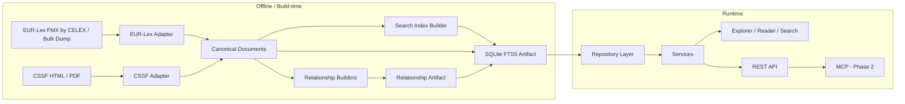
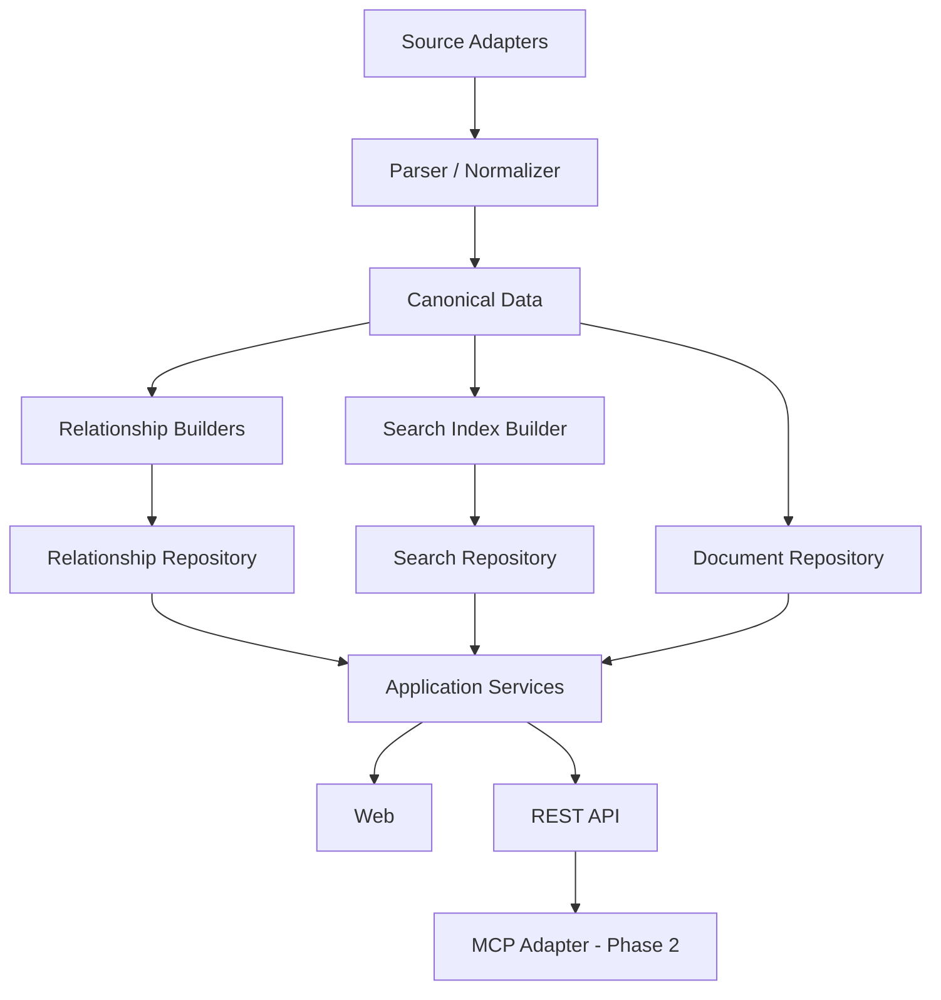

# Regulatory Knowledge Platform — 技术架构与开发实施文档

> 文档版本：v1.1 Revised Technical Baseline  
> 日期：2026-08-23  
> 对应产品需求：`Regulatory Knowledge Platform — 产品需求规格说明书 v3.1 Baseline`  
> 产品语言：English  
> 技术文档语言：中文  
> 目标：把最终版产品需求落实为一套**简单、可落地、可逐步扩展、适合 Codex 协作开发**的工程架构。

---

# 0. 文档定位

本文不是第二份产品需求，而是产品需求的**技术实现基线**。所有技术选择必须服务于需求文档已经确定的核心产品能力：

- Universal One-page Act Explorer；
- Legal Reader；
- Global Command Palette / Search；
- Clickable legal text / Side Peek；
- References / Cited By；
- TF-IDF Article ↔ Recital；
- DORA ↔ RTS/ITS；
- CSSF structural adapter；
- Phase 2 的 CELLAR / CJEU / API / MCP；
- Phase 3 的 regulatory paths / taxonomy / timeline 等能力。

如果本文与产品需求发生冲突，以产品需求为准；如果产品需求没有规定实现方式，则以本文作为默认工程决策。

本项目的技术策略不是追求“技术最多”，而是：

> **用最少的基础设施承载最清晰的数据契约；把复杂度放到可替换的模块内部，而不是散落到整个系统。**

---

# 1. 最终技术结论摘要

Phase 1 默认技术栈：

| 层 | 选择 |
|---|---|
| 主语言 | **TypeScript** |
| Runtime | **Node.js LTS（最低 22）**，初始化时固定版本 |
| Frontend | **React 19** |
| Router | **React Router 7** |
| Build | **Vite** |
| Styling | **Tailwind CSS 4** |
| Motion | **Motion / Framer Motion**，仅用于 Side Peek、Command Palette、轻量过渡 |
| Icons | **Lucide React** |
| Backend | **Express** |
| Runtime DB | **SQLite** |
| Node SQLite driver | **better-sqlite3**，确保 FTS5 可用 |
| Full-text search | **SQLite FTS5 + deterministic ranking** |
| Canonical data | **Normalized JSON documents + manifest** |
| Relationship runtime store | **SQLite relationship table** |
| Relationship export | **JSON nodes/edges / relation export** |
| Article ↔ Recital | **build-time TF-IDF，可配置且通过 benchmark 后启用** |
| EUR-Lex parser | **优先适配 LegalViz 已验证的 Formex parser / resolver** |
| CSSF HTML parsing | **独立 CSSF Adapter；优先 HTML，PDF 为 fallback** |
| Schema validation | **Zod** |
| Unit / integration test | **Vitest** |
| E2E | **Playwright** |
| Lint / format | **Biome + TypeScript compiler** |
| Package manager | **npm**，避免额外工具链 |
| Production deploy | **单 Node 服务 + 静态 React + 单 SQLite artifact** |
| Container | **Docker 可选但推荐用于部署** |
| Phase 2 MCP | **实施时稳定的官方 MCP TypeScript SDK，作为 Service adapter** |
| Phase 2 SPARQL | **HTTP fetch + SPARQL query templates + adapter** |

Phase 1 不需要为了“未来可能用到”预先增加 Redis、Kafka、Kubernetes、Elasticsearch/OpenSearch、GraphQL、复杂 ORM 或分布式服务。未来需要时可替换 repository / adapter，而不是重写 Reader、Explorer 或 Search UI。

---

# 2. 架构总览

## 2.1 两个运行世界：Build-time 与 Runtime

整个项目必须把“数据构建”和“用户访问网站”分开。



核心原则：

1. **网站运行时不解析 FMX source 或 bulk dump**；
2. **网站运行时不实时计算 TF-IDF**；
3. **网站运行时不依赖 CELLAR SPARQL 才能打开 Article**；
4. 所有昂贵、批量、可预计算的工作尽量放在 build-time；
5. runtime 主要做读取、查询、导航和渲染。

这会同时带来简单代码、快响应、可重复构建和良好可追溯性。

## 2.2 长期稳定的模块层次



**依赖只能向下。**

- Web 不允许 import FMX parser；
- MCP 不允许直接访问 raw XML；
- Search ranking 不允许写进 React component；
- CSSF 特例不允许进入 DORA/AI Act 专用 UI；
- Relationship source 不允许被 UI 猜测。

---

# 3. 为什么选择 TypeScript / Node 单栈

## 3.1 目标

该项目 Phase 1 的主要工作不是模型训练或科学计算，而是：

- XML / HTML 解析；
- 数据规范化；
- SQLite / FTS5；
- 浏览器 UI；
- 搜索；
- 引用解析；
- API；
- 后续 MCP。

这些工作完全可以由 TypeScript / Node 一套技术栈覆盖。

## 3.2 选择理由

1. LegalViz 已验证 React/Vite/Express + shared Formex parser 的路线；
2. Parser、Relationship Builder、Search Builder、API、MCP 都可以共享 TypeScript domain types；
3. 减少 Python/Node 两套 dependency、环境、模型定义和序列化差异；
4. Codex 在一个语言栈内更容易做准确重构；
5. SQLite FTS5 在 `better-sqlite3` 下使用简单；
6. Phase 2 MCP 可直接复用同一 Service 层。

## 3.3 Python 的位置

Phase 1 **不把 Python 设为主运行依赖**。

只有在以下情况才引入独立 offline Python utility：

- 某类 PDF 的现有 Python parser 明显优于 Node 实现；
- 某个一次性数据诊断脚本用 Python/Pandas 明显更快；
- 临时研究任务，不进入 production runtime。

原则：Python utility 的输出仍然必须进入 Canonical Contract，不能形成第二套业务模型。

---

# 4. Repository 组织

建议一个 Git repository、一个主 package、一个部署单元；内部按职责分目录，不使用 Nx/Turborepo 等额外 monorepo 框架。

推荐结构：

```text
regulatory-knowledge-platform/
├── AGENTS.md
├── README.md
├── package.json
├── package-lock.json
├── tsconfig*.json
├── vite.config.*
├── biome.json
├── .env.example
├── .gitignore
│
├── docs/
│   ├── regulatory_knowledge_platform_requirements.md
│   ├── regulatory_knowledge_platform_technical_architecture.md
│   ├── adr/
│   └── runbooks/
│
├── core/
│   ├── domain/
│   ├── contracts/
│   └── ids/
│
├── pipeline/
│   ├── acquisition/
│   ├── parsers/
│   │   ├── eurlex/
│   │   └── cssf/
│   ├── normalization/
│   ├── relationships/
│   ├── search-index/
│   └── validation/
│
├── server/
│   ├── repositories/
│   ├── services/
│   ├── api/
│   ├── middleware/
│   └── mcp/                 # Phase 2
│
├── web/
│   ├── components/
│   ├── views/
│   │   ├── explorer/
│   │   ├── reader/
│   │   └── search/
│   ├── hooks/
│   ├── state/
│   ├── api/
│   └── styles/
│
├── scripts/
│   ├── data/
│   └── dev/
│
├── tests/
│   ├── fixtures/
│   ├── parser/
│   ├── search/
│   ├── relationships/
│   └── e2e/
│
└── .local-data/             # ignored by Git
    ├── raw/
    ├── canonical/
    ├── build/
    └── regulatory.sqlite
```

如果 raw dump 希望放在 repo 外，可通过 `REGULATORY_DATA_DIR` 指向，例如：

```text
~/Data/regulatory-platform/
```

**Git 中只保留：**

- 代码；
- schema；
- 小型 test fixtures；
- benchmark snapshots；
- 文档；
- 必要的人工 curated mapping。

不把完整 FMX dump、完整 canonical corpus 或生产 SQLite artifact 提交到 Git。

---

# 5. 数据生命周期

## 5.1 数据的四个状态

### Raw Source

官方原始文件，只做保存和追溯：

- EUR-Lex FMX；
- CSSF HTML；
- CSSF PDF；
- Phase 2 CELLAR response / case source snapshot。

Raw source 不直接供 UI 使用。

### Canonical Data

Parser / Normalizer 输出的统一法律数据，是平台内部的**消费契约**。官方 source artifact 才是法律文本来源；Canonical Data 是可追溯、可验证、可重建的规范化表达，不声明自身具有独立法律权威。

### Derived Data

从 Canonical Data 派生：

- FTS index；
- search aliases；
- TF-IDF relations；
- reverse citations；
- Explorer lightweight structure；
- runtime SQLite。

Derived data 必须可重建，不能成为唯一事实来源。

### Runtime Artifact

网站运行时使用的 compact SQLite + static frontend build。

## 5.2 Build Manifest

每次完整数据构建应生成一个 manifest，记录：

- build ID；
- build time；
- canonical schema version；
- SQLite schema version；
- source snapshot identifier；
- 输入文件数量；
- 输入 checksum；
- 成功 document 数；
- 失败 document 数；
- relationship 数量；
- search index 数量；
- 输出 artifact checksum。
- previous active build ID；
- validation result；
- refresh status / failure summary。

目的：出现问题时可以明确回答“这个页面的数据是哪次构建产生的”。

---

# 6. Canonical Data 技术模型

产品需求已明确：不能假设所有法律都只有 Chapter → Section → Article。

## 6.1 核心实体

至少保持以下一等实体：

| Entity | 说明 |
|---|---|
| RegulatoryFamily | DORA / GDPR / AI Act / MiCA / CSSF 等用户视角的法规族 |
| Document | 一份正式法律/监管文档 |
| StructuralNode | Title / Part / Chapter / Section 等不承载正文的层级节点 |
| Provision | Article / paragraph / point / subparagraph / Recital / Annex 及其内部节点等可定位法律内容的统一基类 |
| Definition | 术语定义 |
| Relationship | 两个实体之间的有来源关系 |
| Case | Phase 2 CJEU case |
| Decision | Phase 3 supervisory/national decision |

`Recital` 与 `Annex` 在产品上是独立 collection，在 Canonical Contract 中仍使用 Provision 的共同字段和 stable-ID 规则，通过 `provision_type` 区分。只有当其专属字段产生真实差异时才增加 subtype，避免正文、搜索和关系层维护平行模型。

Document 与 Provision 至少同时保存：

- `language`；
- logical entity ID；
- source expression/version ID；
- `source_snapshot_id`；
- `display_order`；
- `source_locator`；
- `parser_warnings`；
- Document ↔ RegulatoryFamily 多对多 membership。

## 6.2 Stable ID

ID 不能使用 UI slug 作为事实标识。

建议逻辑 ID：

```text
EU document: eu:<CELEX>
Article:     eu:<CELEX>:article:<n>
Paragraph:   eu:<CELEX>:article:<n>:paragraph:<n>
Recital:     eu:<CELEX>:recital:<n>
Annex:       eu:<CELEX>:annex:<n>
CSSF doc:    lu:cssf:<document-id>
```

logical ID 用于跨视图识别“同一法律实体”，source expression/version ID 用于识别某次具体文本，例如：

```text
eu:<CELEX>:article:<n>@<source-version>
```

显示路径和 URL 可以变化，logical ID 不应变化；不同 source version 的正文、hash 和 provenance 不得覆盖。ID normalizer 必须覆盖 `6a`、罗马数字、重复局部编号、Annex 内部层级和 CSSF 非规则编号。DOM anchor 由 logical ID 映射生成，但不是数据库主键。

## 6.3 Structural Path

每个 Article/Provision 带 `structural_path`，例如：

```text
TITLE III → CHAPTER 2 → SECTION 1
```

而不是强制存成固定三列 `chapter / section / article`。

Explorer 与 TOC 都从同一 structural tree 生成。

## 6.4 Schema Version

每份 Canonical Document 必须带 schema version。

如果未来 schema 变化：

- 通过 migration / rebuild 更新；
- 不允许 UI 靠兼容多个未定义历史 JSON 形状维持运行。

---

# 7. EUR-Lex Ingestion

## 7.1 数据来源

Phase 1 使用 English FMX / Formex 数据作为 EU primary source。

获取顺序：

1. `Release 0.1` 按 CELEX 获取 DORA、GDPR、AI Act、MiCA、NIS2、Data Act；
2. 保存每个 source artifact、checksum、retrieved-at 与官方 URL；
3. 支持显式 refresh 和 metadata/checksum change detection；
4. 核心纵向链路稳定后再引入完整 English dump，用于扩大覆盖和批量兼容性验证；
5. refresh/build 失败不得替换当前 active artifact。

## 7.2 LegalViz reuse strategy

LegalViz 已验证：

- Formex → article/chapter/section/recital/definition/annex；
- internal references；
- cross-law references；
- CELEX resolution；
- HTML fallback；
- shared parser 被 Web/API/CLI 共用。

因此开发顺序必须是：

1. 先运行并理解 LegalViz parser 的输入输出；
2. 用 DORA / GDPR / AI Act / MiCA / NIS2 / Data Act 做 regression fixtures；
3. 根据项目采用的代码复用方式，选择保留来源说明并适配，或按明确输入输出和测试独立实现；
4. 建 Adapter 将 parser 输出转换为本项目 Canonical Model；
5. 只有确认 parser 不适配的部分才改写，不做无价值的机械改名。

若直接复用 `.mjs` shared parser，可以通过 typed adapter 接入并保留其来源/许可证信息；等功能稳定后再决定是否逐步 TypeScript 化。若独立实现，则以公开行为、官方 Formex 样本和本项目 fixtures 为 contract，不逐行转写第三方实现。

## 7.3 Parser 质量门槛

每个核心法规至少校验：

- document title；
- CELEX；
- Article count；
- Recital count；
- Annex count；
- Article numbering sanity（允许 `6a`、删除/保留编号和合法跳号，不以连续性作为硬规则）；
- structural labels；
- paragraph anchors；
- normalized text diff / representative paragraph exact match；
- internal reference resolution rate。

---

# 8. CSSF Ingestion

CSSF 必须作为独立 source adapter，不污染 EUR-Lex parser。

## 8.1 优先级

1. HTML 有结构时优先 HTML；
2. 官方 PDF 为 fallback；
3. PDF 解析只负责恢复结构与正文，不做 AI interpretation；
4. 对结构异常的少数文档允许 curated override，但 override 必须显式记录 provenance。

## 8.2 CSSF Adapter 输出

无论来源 HTML 还是 PDF，都输出同一 Canonical Document：

- authority = CSSF；
- jurisdiction = LU；
- document type；
- official URL；
- publication/update date；
- structural path；
- provisions；
- explicit references。

## 8.3 结构规则

CSSF 可以出现 Part / Chapter / Section / Subsection / Paragraph 等不同层级。Parser 只负责忠实恢复层级，Universal Explorer / Reader 不写 CSSF 特例页面。

---

# 9. Relationship Layer

## 9.1 定位

本地 Relationship Store 不是 CELLAR 的镜像，也不是某一种图数据库的绑定层。

它是平台自己的**统一监管关系模型**，汇聚：

- 原文 explicit references；
- reverse cited-by；
- cross-law links；
- DORA RTS/ITS mapping；
- TF-IDF related recitals；
- Phase 2 CELLAR official relations；
- Phase 2 CJEU article citations；
- Phase 3 topic / decision relations。

## 9.2 Relationship runtime storage

Phase 1 直接使用 SQLite 普通表。

主要字段：

| 字段 | 说明 |
|---|---|
| relationship_id | 确定性或持久化关系 ID |
| source_id | 源实体 stable ID |
| relation_type | REFERENCES / MANDATES / ADOPTED_UNDER / SUPPLEMENTS / RELATED_RECITAL 等受控关系类型 |
| target_id | 目标 stable ID |
| provenance | LEGAL_TEXT / OFFICIAL_METADATA / MANUAL_OFFICIAL_MAPPING / TFIDF 等 |
| evidence_locator | 原文 span、XML path、metadata predicate 或 curated record ID |
| score | TF-IDF 等算法关系分数 |
| source_ref | 原始官方 URL / query / snapshot |
| builder_method / version | 生成器和规则版本 |
| resolution_status | resolved / external / unresolved / ambiguous |
| build_id | 哪次数据构建生成 |

关系表需要唯一约束，至少覆盖 `source_id + relation_type + target_id + provenance + evidence_locator`。`CITED_BY` 默认由 `REFERENCES` 反向查询，不要求保存重复边；只有性能数据证明必要时才物化。RTS/ITS 是 Document type，不编码成 `RELATED_RTS` / `RELATED_ITS` 两套平行关系。

## 9.3 Builder pattern

每种关系来源独立 builder：

```text
ExplicitReferenceBuilder
TfidfRecitalBuilder
OfficialMappingBuilder
CellarRelationshipBuilder        # Phase 2
CaseCitationBuilder              # Phase 2
```

所有 builder 输出同一 Relationship Contract。

## 9.4 为什么 Phase 1 不需要专用“Citation Engine”服务

当前问题可以由简单 builder + resolver 完成：

- Formex 自带链接优先；
- 文本规则 / regex fallback；
- stable ID resolver；
- 反向索引。

如果未来实际出现大量 citation dialect / unresolved edge，再把 resolver 内部升级，不改变 Relationship Contract。

---

# 10. TF-IDF 架构

TF-IDF 属于 Phase 1 后段的可选 lightweight statistical relation。它不阻塞 Reader、Search、explicit references 或 official mappings 发布。

## 10.1 运行位置

**build-time 预计算**，不是浏览器每次实时计算。

## 10.2 输入

同一法案内：

- Articles / provisions；
- Recitals。

## 10.3 输出

对每个 Article 保存 Top-N related recitals：

- target stable ID；
- score；
- method=`TFIDF`；
- build version。

## 10.4 质量策略

- N 可配置，不预设所有法案都必须展示相同数量；
- stopword / token normalization 固定；
- 同一 build 结果确定性；
- 不与 explicit reference 混为同一 provenance；
- 建立一个小型人工 benchmark，检查 AI Act / GDPR / DORA 已知 article-recital pair 的 Top-N 命中；
- build report 记录 benchmark 结果，未达到配置门槛时不向 UI 发布该关系；
- `score` 仅表示文本相似度，不表示法律置信度。

TF-IDF 是代码计算，不需要调用任何 LLM。

---

# 11. Search Architecture

这是 Phase 1 的核心技术模块之一，直接参考 LegalViz 已验证路线。

## 11.1 为什么 SQLite FTS5

需要支持：

- law title / acronym / CELEX；
- full-text；
- definitions；
- snippets；
- phrase search；
- prefix match；
- deterministic ranking；
- 本地单机部署。

SQLite FTS5 已足够，不引入 Elasticsearch/OpenSearch。

`better-sqlite3` 作为 Node driver；构建和启动时必须通过实际创建/查询 FTS5 test table 验证 capability，不能只根据 package 名称假设 FTS5 可用。

## 11.2 Search Index Builder

从 Canonical Data 生成：

### metadata records

- title；
- short name；
- CELEX；
- number/year；
- document type；
- family；
- authority；
- status；
- aliases。

### provision excerpts

- index unit 明确为最小可独立定位且适合展示 snippet 的 Provision；默认 paragraph，有结构限制时回退到 Article/Recital/Annex node；
- stable provision ID；
- law ID；
- article/paragraph label；
- heading；
- normalized plain text；
- display snippet source。

### definitions

- normalized term；
- display term；
- definition text；
- source provision；
- document / family。

## 11.3 Find Laws ranking

顺序原则：

1. exact CELEX；
2. exact known acronym/alias；
3. exact legal number/year；
4. exact normalized title；
5. strong prefix/title match；
6. FTS lexical match；
7. secondary contextual matches。

已知 alias 例如：

- DORA；
- GDPR；
- AI Act；
- MiCA；
- NIS2。

`DORA` 不应因为通用关键词出现而被无关 Regulation 挤到后面。

## 11.4 Full-text

FTS5 返回：

- stable result ID；
- law / family；
- article/paragraph；
- snippet；
- escaped highlight/snippet fragments；
- rank。

点击直接落到 paragraph-level URL。

Search Service 必须拥有独立 query parser：限制 query 长度、token/prefix 数量和结果数，转义或拒绝不支持的 FTS5 syntax，并始终使用 SQL parameter binding。普通用户输入不得直接拼接进 SQL 或未经约束的 `MATCH` expression。

## 11.5 Current-law Quick Go

当前已打开法规使用浏览器端小型 inverted index：

- Article number；
- title；
- Recital number；
- Annex；
- known definitions。

目的不是代替全局 FTS，而是让 Cmd+K / Quick Go 在当前法案内零延迟跳转。

## 11.6 Search Service Contract

UI 不直接 SQL。

Search Service 统一提供：

- find laws；
- search provisions；
- search definitions；
- recent/opened law metadata；
- resolve citation / alias；
- future relation filters。

---

# 12. Runtime SQLite 设计

Phase 1 推荐一个 SQLite artifact，避免多数据库同步。

逻辑表族：

| 表族 | 用途 |
|---|---|
| documents | document/family metadata |
| structural_nodes | Explorer / TOC |
| provisions | Article / paragraph / point / Recital / Annex 等统一可定位正文；可按 type 建 view/index |
| definitions | normalized definitions |
| relationships | unified local relation store |
| aliases | short names / legal citations |
| build_manifest | data lineage |
| *_fts | FTS5 virtual tables |

不使用 Prisma/Drizzle 作为 Phase 1 默认 ORM。

理由：

- FTS5 本身需要原生 SQL；
- 数据模型稳定且表数量有限；
- raw SQL + repository 更直接；
- 避免 ORM 对 FTS / bulk insert / build pipeline 的额外抽象；
- SQLite artifact 是可重建的，不需要复杂 migration framework。

仍需维护编号 SQL migration / schema scripts，并使用 `PRAGMA user_version` 或等效 schema version。

---

# 13. Repository Layer

Repository 是存储替换边界。

逻辑能力至少包括：

- DocumentRepository；
- ProvisionRepository；
- DefinitionRepository；
- RelationshipRepository；
- SearchRepository；
- FamilyRepository。

这些名称描述职责，不要求 `Release 0.1` 立即建立六套 class/interface。初期可以在一个 SQLite repository module 内按函数分组；只有出现替代实现、复杂测试替身或独立变化原因时再拆接口。

要求：

1. Service 不 import `better-sqlite3`；
2. Repository 返回 domain DTO，而不是 SQLite row 任意透传；
3. future storage change 只影响 repository；
4. Web / MCP 不知道 SQLite 路径。

---

# 14. Service Layer

Service 是 Web 与数据访问之间的业务边界，因为 Phase 1 Web、Phase 2 API/MCP 都依赖它。下面名称表示能力分组，不要求每组成为独立进程或无状态 class；优先使用小型函数模块，出现真实复杂度后再拆分。

## 14.1 Document Service

- get law metadata；
- get explorer structure；
- get navigation neighbors；
- get source info。

## 14.2 Provision Service

- get Article / paragraph；
- get Recital / Annex；
- resolve stable ID；
- side-peek payload。

## 14.3 Relationship Service

- outgoing relations；
- incoming relations；
- grouped relationship panel；
- DORA RTS/ITS；
- related recitals；
- Phase 2 cases/amendments。

## 14.4 Search Service

- law search；
- full-text；
- definitions；
- citation resolution；
- query normalization / ranking。

## 14.5 Family Service

- DORA family；
- AI Act family；
- CSSF authority collections；
- Level 1/2/3 groupings。

---

# 15. REST API

Phase 1 使用内部 Web API。它遵守 stable ID、错误语义和 DTO 边界，但在首次公开 API version 发布前允许随 repository 内部版本演进；不得为了尚未存在的外部兼容承诺保留不合理设计。

建议资源风格：

```text
/api/families/:familyId
/api/documents/:documentId
/api/documents/:documentId/structure
/api/provisions/:provisionId
/api/provisions/:provisionId/relationships
/api/search/laws
/api/search/fulltext
/api/search/definitions
/api/resolve
```

API response 必须返回 stable IDs，不让前端靠标题重新识别实体。

错误响应要区分：

- not found；
- unresolved reference；
- source unavailable；
- unsupported document structure；
- build/index mismatch。

Phase 2 MCP 只调用 Service，不通过 HTTP 绕一圈也可以；REST 与 MCP 是两个 adapter。

---

# 16. Frontend Architecture

## 16.1 一个 UI Shell，多种数据视图

```text
Top Navigation
 ├─ Family switch
 ├─ Global Search / Cmd+K
 └─ Theme

Main Views
 ├─ Explore
 ├─ Read
 ├─ Recitals / Annexes
 └─ RTS/ITS / Related
```

Explorer、Reader、Search 不维护各自数据副本。

## 16.2 State 原则

优先级：

1. URL = 可分享的业务状态；
2. React local state = UI 临时状态；
3. Context = 少量跨组件 UI state；
4. localStorage = recently opened、theme、轻量偏好。

Phase 1 不默认引入 Redux/Zustand。

## 16.3 Data fetching

保持轻量：

- native fetch + typed client；
- 简单 request cache；
- Side Peek 可 cache 最近实体；
- 不因为“以后也许需要”预先引入复杂 client state framework。

如果 Phase 2 出现大量后台 mutation、分页和服务器 cache，再评估 TanStack Query。

---

# 17. Universal Explorer

Explorer 是平台 capability，不是每部法规单独写页面。

## 17.1 输入

仅需要：

- document metadata；
- structural tree；
- Article labels/titles；
- lightweight relation counts/badges。

不需要一次下载整部法规所有正文。

## 17.2 Renderer

Universal Explorer 按 structural node 的 `type / number / title / depth / children` 渲染。

因此：

- DORA 显示 CHAPTER / SECTION；
- MiCA 可显示 TITLE / CHAPTER；
- CSSF 可显示 PART / CHAPTER / SECTION；
- chapterless law 自动 flatten。

## 17.3 Interaction

- Article click → Reader；
- relation badge → relationship/RTS context；
- search highlight → Explorer 定位；
- Reader “View in Explorer” → 回到同一节点；
- navigation state 保留滚动位置。

---

# 18. Legal Reader

## 18.1 三栏结构

- 左：Adaptive TOC；
- 中：official legal text；
- 右：relationship context。

## 18.2 Inline reference handling

渲染顺序：

1. parser 提供的 structured ref；
2. resolver 补充 stable target；
3. unresolved ref 显示为普通文本或外部官方链接；
4. 不允许前端临时用正则重复解析整段正文。

## 18.3 Side Peek

Side Peek 请求一个精简 `ProvisionPreview`：

- target title；
- label；
- excerpt / full short provision；
- source law；
- open full target action。

Side Peek 不改变主页面 URL；只有用户选择 “Open full” 才导航。

## 18.4 Paragraph anchors

Paragraph / point 必须有稳定 DOM anchor，由 provision stable ID 映射，而不是按纯文本内容 hash 动态生成。

---

# 19. Global Command Palette

直接参考 LegalViz 的成熟交互：

- Cmd/Ctrl+K；
- modal/overlay；
- live search；
- keyboard navigation；
- Best Match；
- tabs/modes：Find Laws / Opened Laws / Definitions / Full-text；
- Enter open；
- Esc close。

Search UI 只负责交互，不实现 ranking。

首页大搜索框与全站 Cmd+K 使用同一 Search Service 和同一结果组件。

---

# 20. DORA Regulatory Family

DORA 的 Level 2 是 Phase 1 核心差异化能力。

## 20.1 Family data

DORA family 包含：

- primary act；
- recitals；
- RTS；
- ITS；
- future guidelines/Q&A slot。

## 20.2 RTS/ITS mapping

Phase 1 允许 official curated mapping：

- Article mandate / legal basis → RTS/ITS；
- RTS/ITS → mandate / source Article；
- mapping 必须记录官方依据与 source URL。

人工核验的 mapping 以版本控制的 YAML/JSON source record 保存，再由 `OfficialMappingBuilder` 导入统一 Relationship Store。UI 不直接读取 mapping 文件，也不维护 DORA 专用关系真相。

## 20.3 UI consumption

同一关系可用于：

- DORA landing RTS library；
- Article relationship panel；
- Explorer badge；
- search result context；
- Phase 2 MCP `get_related_acts`。

---

# 21. Phase 2 技术扩展

Phase 1 必须确保以下功能可以通过新增 adapter/builder/service 实现，不更换核心架构。

## 21.1 CELLAR SPARQL

新增：

```text
CellarClient
CellarRelationshipBuilder
```

流程：

```text
Seed Documents / CELEX
  → SPARQL query
  → normalize official predicates
  → Relationship Contract
  → local Relationship Store
```

不让 Reader 直接向 CELLAR 查询。

## 21.2 Amendment / Version

Canonical Document 已有：

- publication/effective/application dates；
- source snapshot；
- external IDs。

Phase 2 增加 document-level version relationships 即可。

## 21.3 CJEU

参考 LegalViz：

- SPARQL discover cases；
- fetch judgment source；
- parse operative part / article citations；
- normalize Case entity；
- build `CITES / CITED_BY_CASE` edges。

仍进入同一 Relationship Repository。

## 21.4 MCP

MCP 是 Service Adapter，不拥有业务逻辑。

优先工具：

- search_law；
- resolve_law；
- get_law_structure；
- get_provision；
- get_related_acts；
- get_definitions；
- get_case_law；
- get_family_documents。

MCP 返回结构化官方数据与 provenance，不在 MCP 内再次生成“AI 法律解释”。

---

# 22. Phase 3 技术预留

Phase 3 可能增加：

- topic taxonomy；
- applicability；
- implementation timeline；
- decisions；
- multi-hop regulatory paths；
- richer relationship persistence / specialized graph querying。

当前只要求：

- stable node IDs；
- relation type 可扩展；
- provenance；
- repository abstraction；
- dates / authority / jurisdiction 字段；
- API/MCP 不依赖 SQLite schema 细节。

具体数据库技术到 Phase 3 根据真实查询负载再决定。

---

# 23. Production Deployment

## 23.1 开发环境

典型：

```text
Vite dev server          :5173
Express API              :3000
SQLite artifact          .local-data/regulatory.sqlite
```

## 23.2 Production

```text
npm build
  → static web dist
  → server bundle
  → regulatory.sqlite

single Node process
  ├─ /api/*
  └─ static frontend
```

一个容器或一台普通 Linux VM 即可。

## 23.3 Data build 与 Web deploy 分开

Data build 可以在开发机/构建机手动运行：

```text
raw source → canonical → relationships → search index → SQLite artifact
```

生成经过 validation 的 artifact 后再部署。

发布流程必须使用 staging path 构建和验证，完成后以原子 rename/symlink switch 或等价机制切换 active artifact，并保留至少一个 previous artifact。schema/build ID 不兼容或 health check 失败时立即回退。

Phase 1 不要求生产服务器自己下载 bulk dump。

---

# 24. Configuration

建议配置类别：

| 类别 | 示例 |
|---|---|
| data | `REGULATORY_DATA_DIR` |
| server | `PORT`, `HOST` |
| database | `REGULATORY_DB_PATH` |
| environment | `NODE_ENV` |
| source | EUR-Lex/CSSF endpoint base URL |
| build | TF-IDF top-N、fixtures、strict mode |

配置必须集中读取和验证，不能在代码各处直接 `process.env.X`。

Zod 验证启动配置，错误时 fail fast。

---

# 25. Logging / Observability

Phase 1 不需要复杂 APM，但需要结构化日志。

推荐：

- server request log；
- build pipeline log；
- parser error summary；
- relationship unresolved summary；
- search build statistics；
- build manifest。

生产至少有：

- `/health`；
- build ID；
- DB schema version；
- canonical schema version。

出现数据问题时能够快速区分：

- source 问题；
- parser 问题；
- index 问题；
- runtime/API 问题。

---

# 26. 安全与数据完整性

这是公开法规读取产品，Phase 1 风险不高，但要守住基础边界。

## 26.1 Legal HTML

- 解析后 legal HTML 必须经过 allowlist / sanitization；
- 不直接信任源 HTML script/style；
- 只保留需要的 semantic markup；
- external link 使用安全属性。

## 26.2 文件路径

API 不接受任意 raw file path；document lookup 只能通过 stable ID。

## 26.3 SQLite

- 运行时以 read-only 模式打开 production artifact；
- 所有 SQL 值使用 parameter binding；
- 服务启动时校验 schema version、build ID、integrity check 与 FTS5 capability；
- artifact 更新只通过受控发布流程，不允许 HTTP API 写入 production DB。

## 26.4 Source Integrity

- 保存 source URL；
- 保存 source snapshot checksum；
- canonical transformation 可重建；
- derived relations 保存 provenance。

## 26.5 HTTP Boundary

- 配置基础 security headers；
- 限制 URL、query、body 和返回结果大小；
- 对 search/resolve endpoint 配置轻量 rate limit 与 timeout；
- external URL 只允许 `http/https`，前端新窗口链接使用 `noopener noreferrer`；
- 错误响应不暴露文件路径、SQL 或 source artifact 内部位置。

---

# 27. Testing Strategy

测试的重点不是追求 coverage 数字，而是保护法律文本、结构和引用不被重构破坏。

## 27.1 Parser Golden Fixtures

至少：

- DORA；
- GDPR；
- AI Act；
- MiCA；
- NIS2；
- Data Act；
- 2–3 个不同结构 CSSF 文档。

每个 fixture 记录：

- counts；
- representative structural tree；
- representative paragraphs；
- known references；
- definitions；
- source hash。
- source expression/version ID；
- parser warnings；
- expected unsupported constructs（如有）。

## 27.2 Relationship Tests

- explicit ref target；
- reverse cited-by；
- cross-law CELEX resolution；
- provenance；
- DORA RTS mapping；
- TF-IDF deterministic output。

## 27.3 Search Eval Set

维护人工 query set，例如：

```text
DORA
32022R2554
2022/2554
Article 28 DORA
ICT risk management
management body
controller
high-risk AI
CSSF 12/552
```

每个 query 定义 expected top result / expected minimum result。

搜索改动必须跑 eval，而不是凭感觉判断 ranking。

## 27.4 E2E

Playwright 保护核心用户流：

1. 首页 search → DORA；
2. DORA Explorer → Article 28 Reader；
3. Reader inline ref → Side Peek；
4. Reader → View in Explorer；
5. Cmd+K → definition；
6. full-text result → paragraph anchor；
7. Article → related RTS；
8. dark/light + responsive basic checks。

---

# 28. Data Quality Gates

完整 build 发布前必须通过：

1. canonical schema validation；
2. core law parse checks；
3. stable ID uniqueness；
4. dangling/ambiguous relation counts 不超过由 release 配置声明的门槛；
5. duplicate provision detection；
6. article count sanity；
7. FTS row/document count consistency；
8. version-controlled search query eval 全部满足 expected Top-1 / minimum result；
9. official mapping provenance completeness；
10. build manifest complete。

如果 core law 结构失败，应 fail build，而不是“尽量上线”。

---

# 29. Performance Baseline

Phase 1 目标以普通单机为基准，不依赖缓存集群。benchmark 必须记录 CPU、内存、Node/SQLite 版本、corpus/build ID、cold/warm 状态和样本数。

建议预算：

| 场景 | 目标 |
|---|---|
| Home → initial UI | 使用生产构建记录 Core Web Vitals / payload，不以主观“感知快速”作为验收 |
| Find Laws | warm P95 <100ms server query |
| Full-text FTS | 固定常见查询集 warm P95 <250ms |
| Provision fetch | warm P95 <100ms API response |
| Side Peek | 感知即时，允许 client cache |
| Explorer structure | 不下载整部正文；结构 payload 可控 |
| Current-law Quick Go | client-side instant |

性能优化优先顺序：

1. 减小 payload；
2. build-time precompute；
3. SQLite indexes；
4. client caching；
5. 再考虑更复杂基础设施。

---

# 30. Git / CI / Development Workflow

## 30.1 Branch

保持简单：

- `main` 始终可构建；
- feature branch；
- 小 PR / 小 commit；
- milestone 完成后 tag。

## 30.2 CI

每个 PR 至少执行：

- typecheck；
- lint/format check；
- unit tests；
- parser fixture tests；
- search eval；
- web build；
- selected Playwright smoke tests。

CI 不下载完整 bulk dump；CI 使用 fixtures。

## 30.3 Local Full Data Validation

完整数据 build 是独立显式任务：

- 手动触发；
- 输出 build report；
- 不因为普通 UI PR 每次重复跑完整数据。

---

# 31. Codex 协作开发原则

Codex 是开发工具，不是 production canonical pipeline 的运行依赖。模型名称、价格、额度和 reasoning effort 会变化，因此不写入长期架构 contract，也不按固定模型绑定 Milestone。

长期稳定规则：

1. 确定性脚本优先处理下载、解析、校验、索引、TF-IDF、统计和批量任务；
2. 模型只读取完成当前任务所需的文档、代码、fixture、统计与代表性失败样本；
3. Canonical build 在没有模型 API 的情况下必须完整运行；
4. 修改 stable ID、Canonical Contract、relationship semantics 或 legal-text fidelity 时，必须进行更高强度 review 和回归测试；
5. 并行任务按模块边界划分，不让多个任务同时修改同一核心 contract；
6. AGENTS.md 只保存稳定约束、测试命令、允许的操作和目录职责，不复制整份需求或技术文档；
7. 具体模型和 reasoning effort 由当时可用能力、成本和代表性 eval 决定，从满足质量门槛的最低成本配置开始；
8. 模型生成的任何 enrichment 必须是可关闭的独立 builder，并带 method/model/prompt version provenance，不得混入 official text。

大型数据任务采用：

```text
deterministic batch script
  → statistics / error signatures / representative samples
  → targeted model analysis when needed
  → code change
  → fixtures / full validation
```

建议在根 `AGENTS.md` 只写：

- 阅读 requirements / technical docs 中与当前任务相关的章节；
- 依赖方向和 Canonical Data invariants；
- raw data 不进入 Git；
- parser/relationship/search 改动必须运行的测试；
- review/diagnose 请求只读，明确要求实现时才修改；
- destructive、external 或 scope-expanding action 需要确认。

模型选择和 reasoning effort 不进入 ADR；如确需记录阶段性成本策略，放在可随时更新的 runbook，而不是本技术基线。

# 32. 代码简单性规则

这些规则比选择某个框架更重要：

1. 一个部署应用优先；
2. 一种主语言优先；
3. 一份 Canonical Contract；
4. 一个 runtime SQLite artifact；
5. Search、Relationships、Reader 通过 Service 连接；
6. 不为未来预建微服务；
7. 不为 FTS 上 ES；
8. 不为普通 CRUD 上 ORM；
9. 不为简单状态上 Redux；
10. 不为关系可视化提前绑定某一种图数据库；
11. 先理解和验证 LegalViz 已证明的外部行为，再选择保留来源适配或独立实现；
12. build-time 能解决的问题不留给 runtime；
13. script 能解决的问题不交给 LLM；
14. 模型和 reasoning effort 只有在代表性 eval 显示质量收益时才升级。

---

# 33. Architecture Decision Records（初始清单）

建议在 `docs/adr/` 保存短 ADR。初始状态：

| ADR | 决策 | 状态 |
|---|---|---|
| ADR-001 | TypeScript/Node 作为主栈 | Accepted |
| ADR-002 | React/Vite SPA，不使用 Next.js | Accepted |
| ADR-003 | Express 单后端 | Accepted |
| ADR-004 | Canonical JSON 是内部消费契约，官方 source artifact 是来源；SQLite 是 runtime/derived store | Accepted |
| ADR-005 | better-sqlite3 + FTS5 | Accepted |
| ADR-006 | Phase 1 不使用 ORM | Accepted |
| ADR-007 | Search = deterministic resolver + FTS5 | Accepted |
| ADR-008 | TF-IDF 仅在 benchmark 通过后以 build-time enrichment 发布 | Accepted |
| ADR-009 | Unified Relationship Contract + provenance | Accepted |
| ADR-010 | EUR-Lex / CSSF 通过 Source Adapter | Accepted |
| ADR-011 | Universal Explorer / Reader 共用数据 | Accepted |
| ADR-012 | 先验证 LegalViz proven behavior，再选择保留来源适配或独立实现 | Accepted |
| ADR-013 | MCP = Service Adapter（Phase 2） | Accepted |
| ADR-014 | Relationship persistence 与未来专用图技术解耦 | Accepted |
| ADR-015 | Canonical build 不依赖 LLM | Accepted |
| ADR-016 | Codex 不进入 canonical runtime/build dependency | Accepted |

---

# 34. LegalViz 参考与复用清单

LegalViz 是 Phase 1 的第一 reference implementation。

当前公开项目说明其技术栈为 React 19、React Router 7、Vite、Tailwind 4、Framer Motion、Lucide React、Express；同一 Formex parser 服务 Web / REST / CLI；客户端有 inverted index 与 TF-IDF；CJEU 通过 SPARQL 发现并解析 article reference。

主要参考：

- https://github.com/maastrichtlawtech/legalviz.eu
- `backend/shared/formex-parser/fmxParser.mjs`
- `backend/search/search-ranking.js`
- `backend/search/build-sqlite-data.js`
- `backend/search/fulltext-index-build.js`
- `backend/search/definition-index-build.js`
- `backend/search/citation-graph-build.js`
- `backend/search/case-law-*.js`
- `src/components/law-viewer/LawViewerToc.jsx`
- `src/utils/law-viewer/tocFormat.js`
- `backend/mcp/`

## 34.1 优先评估适配或独立实现

- Formex parsing；
- reference resolution；
- search alias/ranking patterns；
- SQLite FTS build patterns；
- definition index；
- TOC behavior；
- Cmd+K interaction；
- URL state；
- TF-IDF idea/implementation；
- citation reverse-index pattern。

## 34.2 在其基础上增强

- structural_path；
- Universal one-page Explorer；
- RegulatoryFamily；
- DORA RTS/ITS；
- CSSF；
- relationship provenance；
- broader search corpus；
- API/MCP family tools。

---

# 35. 其他 benchmark 在技术上的用途

## artificialintelligenceact.eu

主要用于：

- One-page Act Explorer visual hierarchy；
- Article context metadata；
- paragraph deep-link；
- implementation documents/timeline 的未来数据模型。

## ai-act-law.eu / gdpr-info.eu

主要用于：

- 极简 reader typography；
- Article ↔ Recital presentation；
- Annex/Recital independent browsing。

## EBA / ESMA Single Rulebook

主要用于：

- Level 1 ↔ RTS / ITS / Guidelines / Q&A relationship semantics；
- regulatory family information architecture。

## regulation-dora.eu

主要用于：

- DORA family landing；
- pillar/topic 后续扩展；
- implementation artefact thinking。

## GDPRhub

主要用于 Phase 3：

- Article ↔ decisions；
- authority/jurisdiction metadata。

---

# 36. First Implementation Sequence（工程版）

按以下顺序降低返工，同时保证尽早得到可运行的纵向链路。DORA 只是第一个工程 fixture，不缩减最终多法规范围。

## Step 1 — Minimal Repo / Contracts

- repo scaffold；
- TypeScript；
- 最小 core domain；
- stable ID；
- canonical schema；
- Zod validation；
- AGENTS.md；
- 只记录已经作出的关键 ADR。

## Step 2 — DORA Vertical Slice

- 获取单个 CELEX source；
- parser / adapter → canonical；
- SQLite artifact；
- Document/Provision repository；
- 最小 Reader / TOC route；
- source version / build manifest；
- golden fixture。

这一阶段的目标是尽早验证完整依赖方向，不形成 DORA 专用页面或专用 Canonical Model。

## Step 3 — Six-law Parser Generalization

- DORA；
- GDPR；
- AI Act；
- MiCA；
- NIS2；
- Data Act；
- adapter → canonical；
- golden fixtures。

## Step 4 — Reader / Explorer Foundation

- nav；
- routes；
- Explorer；
- Reader；
- TOC。
- paragraph deep link；
- refresh/change detection；
- artifact validation / rollback。

## Step 5 — Search

- metadata aliases；
- FTS5；
- definitions；
- Command Palette；
- eval set。

## Step 6 — Clickable law

- reference resolver；
- relationship table；
- Side Peek；
- Cited By。

## Step 7 — Official Relationships / RTS

- DORA / MiCA mappings；
- relationship panel/badges。

## Step 8 — TF-IDF Experiment

- benchmark fixture；
- build-time TF-IDF；
- quality gate；
- benchmark 通过时启用 UI。

## Step 9 — CSSF

- representative documents；
- HTML adapter；
- PDF fallback as needed；
- search/Explorer/Reader integration。

## Step 10 — Full-data Build / Polish

- full English dump validation；
- performance；
- accessibility；
- deploy artifact / atomic publish / rollback runbook。

---

# 37. Definition of Done — Releases

每个 Release 必须有独立 DoD、build ID、source snapshot 和已知限制。下面是 Phase 1 最终累计完成条件，不阻塞前序 Release 独立部署：

### Data

- DORA / GDPR / AI Act / MiCA / NIS2 / Data Act 可由同一 pipeline 解析；
- canonical schema versioned；
- source hashes 可追溯；
- CSSF representative docs 可进入同一 model。

### Architecture

- Web 不依赖 parser/raw data；
- Service 不依赖 React；
- MCP future adapter 不需要改 Service；
- storage 可由 Repository 替换；
- Explorer/Reader 使用同一 stable IDs。

### Search

- SQLite FTS5 可完整重建；
- known aliases Top-1 正确；
- search eval 通过；
- paragraph deep-link 正确。

### Relationships

- explicit reference；
- cited-by；
- DORA/MiCA RTS/ITS；
- TF-IDF benchmark；达到门槛时发布 related-recital artifact；
- provenance 完整。

### UX

- universal Explorer；
- adaptive TOC；
- Reader；
- Side Peek；
- Cmd+K；
- responsive；
- keyboard flow。

### Engineering

- CI 通过；
- parser fixtures；
- E2E smoke；
- build manifest；
- no full raw data in Git；
- AGENTS.md / ADR / runbook complete。

---

# 38. 参考资料

## 产品 / 开源实现

- LegalViz: https://legalviz.eu/
- LegalViz source: https://github.com/maastrichtlawtech/legalviz.eu
- AI Act Explorer: https://artificialintelligenceact.eu/ai-act-explorer/
- AI Act Law: https://ai-act-law.eu/
- GDPR Info: https://gdpr-info.eu/
- Regulation DORA: https://www.regulation-dora.eu/
- EBA Interactive Single Rulebook: https://www.eba.europa.eu/regulation-and-policy/single-rulebook/interactive-single-rulebook
- ESMA Interactive Single Rulebook: https://www.esma.europa.eu/publications-and-data/interactive-single-rulebook
- GDPRhub: https://gdprhub.eu/

## Official data

- EUR-Lex: https://eur-lex.europa.eu/
- CELLAR: https://op.europa.eu/en/web/cellar
- CSSF: https://www.cssf.lu/

## OpenAI / Codex

- Models: https://developers.openai.com/api/docs/models
- Current OpenAI model guidance: https://developers.openai.com/api/docs/guides/latest-model
- Codex AGENTS.md guide: https://developers.openai.com/codex/guides/agents-md
- Codex source: https://github.com/openai/codex

---

# 39. 最终技术原则

整个工程长期遵守以下 16 条：

1. **Official data first**；
2. **Canonical contract first**；
3. **Stable IDs before URLs**；
4. **One canonical dataset, multiple views**；
5. **Relationships are first-class and provenance-aware**；
6. **Build-time before runtime when possible**；
7. **Deterministic code before statistical method**；
8. **TF-IDF before heavier semantic machinery when it solves the problem**；
9. **SQLite/FTS5 before distributed search**；
10. **One deployable application before microservices**；
11. **Repository/Service boundaries before database specialization**；
12. **Reuse proven LegalViz patterns before rebuilding**；
13. **Universal Explorer / Reader, never per-law duplicated pages**；
14. **Script before LLM for data processing**；
15. **Model choice follows current capability and representative evals**；
16. **Future-capable contracts, present-simple implementation**。

最终目标不是拥有最多的技术，而是让以下链路稳定成立：

```text
Official Sources
    ↓
Canonical Legal Data
    ↓
Explainable Relationships + Search
    ↓
Reusable Services
    ↓
Explorer / Reader / Search / API / MCP
```

只要这条链路保持清晰，后续加入 CJEU、CELLAR、更多 CSSF/EBA/ESMA 文件、MCP、监管路径和更高级可视化，都属于“增加能力”，而不是“重做系统”。
